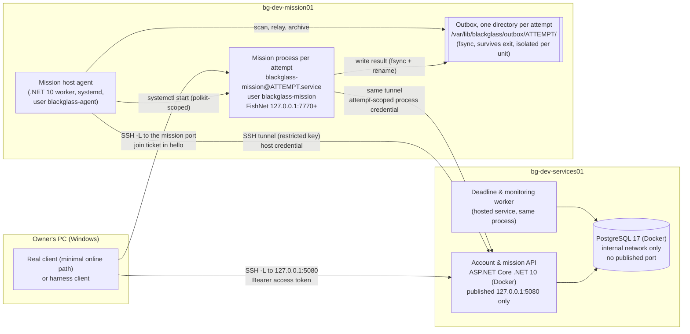
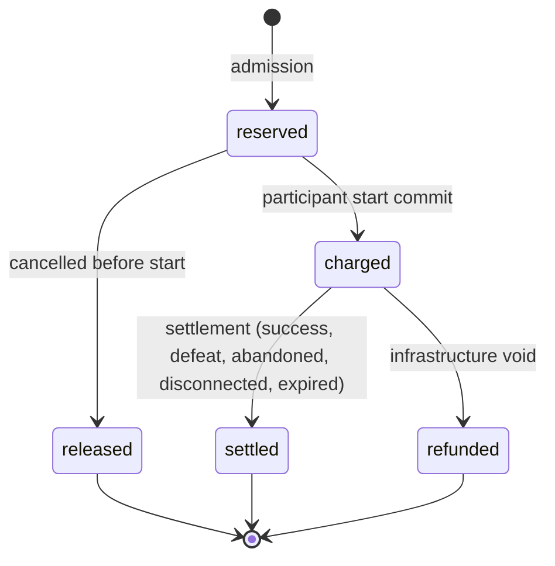
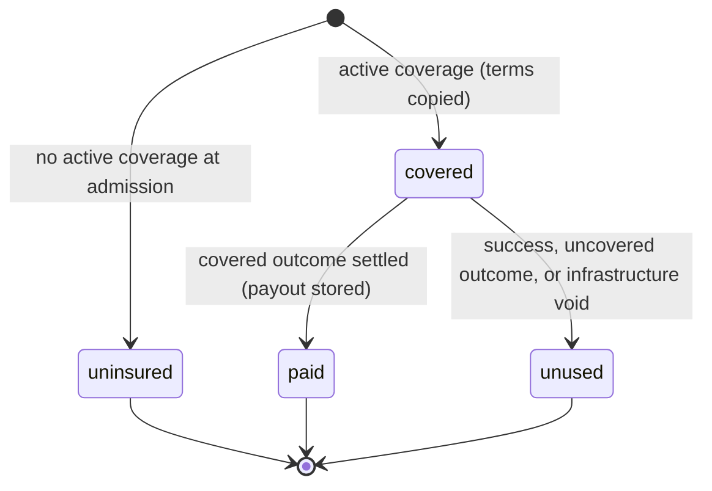
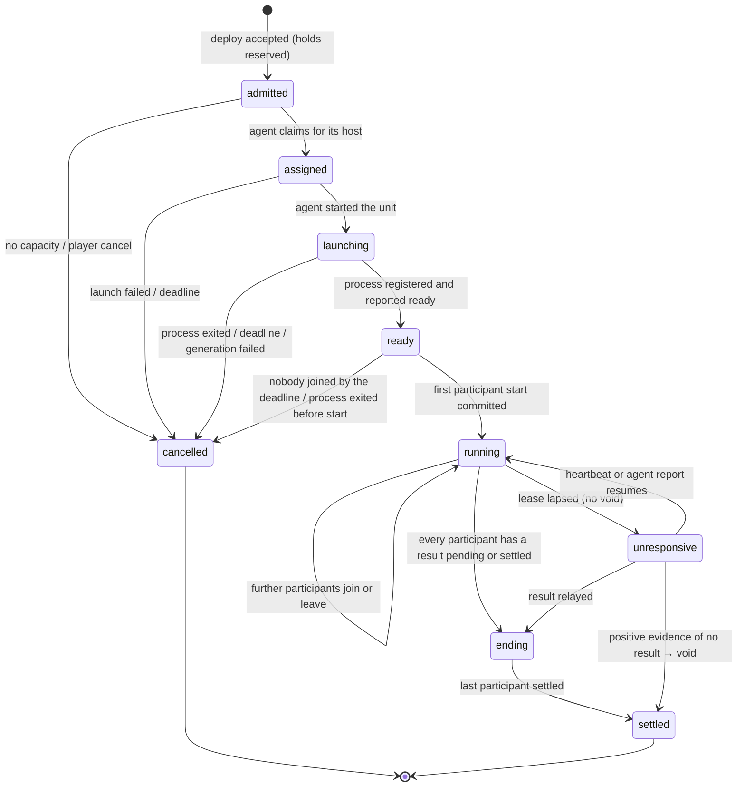

# Phase 13A: backend architecture and persistent mission settlement (design)

Date: 2026-10-14. **Revision 2.6** (Stage 6 owner rulings E1–E7 of 2026-10-16, §0.6); revision 2.5 (Stage 5 owner rulings S5-D1–S5-D8 of 2026-10-16, §0.5); revision 2.4 (Stage 4 owner rulings D1–D6 of 2026-10-15, §0.4); revision 2.3 (Stage 3 security corrections requested by the owner on 2026-10-15, §0.3); revision 2.2 (account ids, owner decision of 2026-10-14, §0.2); revision 2.1 was approved by the owner with the final rulings of 2026-10-14. Base: `main` @ `be26534`. Recorded as decisions 048–050. This document is a design only. It changes no source, scene, package, project setting or infrastructure.

"Project Blackglass" is an internal codename. No identifier, table, route, credential or claim introduced here carries the product name, apart from the C# namespace and repository paths that already exist. Player-facing names live in data (`display_name`), never in keys.

**Labels:**
- **[O]**: observed in the code or docs at `be26534`.
- **[P]**: proposed by this design.
- **[R-n]**: an owner ruling from the 2026-10-14 review, incorporated (§20.1).
- **[A-n]**: a revision-1 proposal, accepted by the owner on 2026-10-14 (§20.2).
- **[Q-n]**: a question the owner ruled on finally on 2026-10-14 (§20.3).
- **(provisional)**: a value that is configurable and not decided (§19).

Companion documents:
- the staged plan, `Docs/superpowers/plans/2026-10-14-phase-13-backend.md`;
- the Stage 0 drafts (decision records, the `CLAUDE.md` update, the audit note), `Docs/superpowers/specs/2026-10-14-phase-13-stage0-drafts.md`.

---

## 0. Revision 2 change summary

| Area | Revision 1 | Revision 2 | Source |
|---|---|---|---|
| Backend unreachable mid-mission | The server stopped after the lease plus a grace period; the worker voided | The mission continues; the result is journaled durably and retried until acknowledged; pending is shown to players; **no automatic void on lost connectivity** | D-11, correction 2 |
| When an attempt is voided | Lease loss, then the grace period ran out | Only with **positive evidence** that no valid result exists: the host agent reports the process ended and its outbox holds no result, or an operator declares the host lost, or an operator authorizes a protective void of a quarantined (invalid) result after re-validation and an outbox check [Q-2, revised in 2.1] | D-10, corrections 2 and 3 |
| Outbox | Redelivered by the next mission process | A separate **mission host agent** owns the outbox. It survives the mission process exiting, restarts on its own, and also launches processes and reports crashes | Correction 3, D-15 |
| Mission processes | Pre-started, single-use | **Launched on demand** per attempt by the agent through a systemd template unit, under an unprivileged user; prewarming deferred until the startup time is measured | D-15 |
| Mission start | Backend commit after the first join | Server ready **plus** a redeemed ticket for that participant **plus** the backend's start commit, per participant. Launching a process charges nothing | D-5 |
| Consumable provenance | Count replay of uses against pickups | A **provenance ledger** of lots (owned / loot line) that follows every merge, transfer and use; looted units are used first; conservation is checked at settlement | D-7 |
| Insurance retention | The first N items picked up | **Backend-controlled deterministic selection** from eligible loot still held at the end: ranked by policy, ties broken by a per-attempt secret salt; computed once and stored | D-8 |
| Refund abuse | Refunds suspended above a per-account threshold | **Removed.** Replaced by anomaly monitoring, investigation and service-health admission controls | Correction 1 |
| Co-op | Schema allowed several participants | Each participant has its **own** hold, insurance snapshot, inventory lock, result manifest, outcome and settlement row | Correction 4, D-3 |
| One active attempt | Inventory row lock plus an `active_attempt_id` column | A **PostgreSQL partial unique index** on active participations, plus the lock order (§15.3) | D-3, correction 5 |
| Docker and firewall | `ufw` enabled | Docker bypasses `ufw` for published ports. Loopback-only publishing, no PostgreSQL port, a daemon default bind address, IPv4 and IPv6 exposure checks, and an SSH-safe `ufw` sequence (§4.5) | Correction 6 |
| Mission server trust | "Bounded by validation" | An explicit residual trust boundary and its mitigations (§13.3) | Correction 7 |
| Backups and migrations | Mostly Phase 14 | A pre-migration backup, a restore drill and migration safety rules are part of the **backend foundation** (Stage 1) | Correction 8 |
| Values | Placeholders scattered through the text | One provisional-values register; each value is configuration (§19) | Correction 9 |
| Advancement picks | Proposed for Phase 13 | **Persisted in Phase 13 without expanding progression** | C-4 |
| Real client | Harness-driven Phase 13 | Harness for incremental acceptance; a **minimal authenticated real-client path** is required before Phase 13 is complete [Q-1] | D-1 |
| Abilities | On the server | **Executed authoritatively on the Linux server** through the existing simulation and rules | D-24 |
| Audit schema | Mentioned | Replaced; the changes are listed in §21.2 and in the drafted audit note | C-6 |

### 0.1 Revision 2.1 (final rulings, 2026-10-14)

| Area | Revision 2 | Revision 2.1 |
|---|---|---|
| Q-1 real client | Proposed | **Approved:** a separate minimal online entry scene; offline scenes, HUD and controls preserved (§14.7) |
| Q-2 quarantine | Automatic void at 24 h | **24 h triggers operator escalation, not a void.** The operator first re-validates the stored original manifest and checks the host's outbox; a protective void needs an explicit operator authorization that records those checks. Alerts repeat until it is resolved (§10.4) |
| Q-3 lost host | Operator only, proposed | **Approved:** an operator-authorized void only; never on heartbeat expiry (§11.1) |
| Q-4 late result after void | Proposed | **Approved:** `409`, the existing receipt preserved, an anomaly recorded; reconciliation is Phase 14 |
| Q-5 host agent | Proposed | **Approved with conditions:** polkit allows only `blackglass-mission@<canonical lowercase UUID>.service`, and only start and stop; the template and the binary it runs are root-owned and fixed (§7.4) |
| A-19 insurance stacking | Newest grant wins | **Replaced:** activating the same benefit again **extends** the remaining coverage; benefits never multiply; cross-tier activation is refused for now (§6.2) |
| Docker default bind | `"ip": "127.0.0.1"` (default bridge only) | Adds `default-network-opts` for user-defined bridge networks (Compose); Docker Engine ≥ 28 verified; explicit loopback publish kept (§4.5) |
| Exposure checks | TCP only | IPv4 and IPv6, TCP and UDP. The existing `systemd-resolved` listeners are accounted for, and LLMNR is disabled through a drop-in. SSH is preserved (§4.5) |
| Stack consumption | `UPDATE … quantity - q`, then delete the zero rows (would violate `quantity > 0`) | `DELETE` when fully consumed, `UPDATE` when partially consumed; the constraint is untouched (§10.3) |
| Regeneration | Materialized, not in the ledger | Every materialization writes a `regen` ledger entry keyed by the anchor it consumed; a reconciliation check compares wallet and ledger (§6.1) |
| Outbox tampering | One shared directory | **One directory per attempt.** A unit can write only its own directory and can't see the others (systemd mount namespace, kernel-enforced); the agent reads through its group and never writes (§9.2) |
| Reconnect during a backend outage | Not handled | Process-issued **resume tokens** re-admit without the backend; the reconnect window and hard cap count only time when the backend was reachable (§11.2) |
| Deploy idempotency | Same key → stored response | Same key **and** body → stored response; same key, different body → `409 IdempotencyKeyReused`, nothing created or charged (§7.3) |
| Minted item ids | `uuidv5(attempt:account:line)` | `origin_ref` = kind, attempt, account, container, line and **unit index**; one id per unit of a non-stackable line (§4.7) |

### 0.2 Revision 2.2 (account ids, owner decision, 2026-10-14)

| Area | Revision 2.1 | Revision 2.2 |
|---|---|---|
| Account id | UUIDv7 minted by the API | **`bigint generated always as identity`**, minted by PostgreSQL only; every account foreign key is `bigint`. Outside the database it is the canonical **Base58** string (Bitcoin alphabet, at most 11 characters, strict parsing), always a JSON string. Decision 048 amendment (§4.1, §4.7, §15.1, §16) |
| Other ids | UUIDv7 | Unchanged: attempts, sessions, credentials and insurance activations stay UUIDv7; tokens stay opaque |

### 0.3 Revision 2.3 (Stage 3 security corrections, owner request, 2026-10-15)

| Area | Revision 2.2 (Stage 3 as first built) | Revision 2.3 |
|---|---|---|
| Revocation | The app role could set `revoked_at` back to null | Permanent: migration `0002_revocation_is_final` (a trigger) refuses clearing or changing a set `revoked_at` (§15.1). Later planned migrations move up one number |
| Lock waits | Unbounded in Stage 3 | `lock_timeout` 5 s and `statement_timeout` 15 s on every API and admin CLI connection, configurable; a timeout rolls back and is 503 with `Retry-After` (§15.3) |
| Revocation times | Stamped by `statement_timestamp()` in a statement that could itself wait on a row lock | Rows are locked by an earlier statement and stamped by a later one, so every stamp follows every wait (§15.3) |
| Database errors | Every database exception was 503 | Unavailable is 503; busy is 503 with `Retry-After`; known conflicts get 409 or 422; anything else is 500. No server message in a body or a log (§4.2, §16.1) |
| Admin CLI | `--account <Base58 id>`, acted at once | `--account-base58 <id>` (an id is never read as decimal). A change to an existing account shows its target and acts only when confirmed, by typing the Base58 id at a terminal or with `--yes` (§4.2) |

### 0.4 Revision 2.4 (Stage 4 owner rulings D1–D6, 2026-10-15; decision 048 amendment 2)

| Area | Revision 2.3 | Revision 2.4 |
|---|---|---|
| Operative and item-instance ids | Operative UUIDv7 (API); minted item UUIDv5 of `origin_ref` | **`bigint` identity, minted by PostgreSQL**, Base58 outside, like accounts. Exactly-once minting comes from the unique `(origin, origin_ref)` key and atomic transactions: insert on conflict do nothing, else read the committed row (§4.7) |
| Provisioning | Unspecified ("idempotent provisioning") | **In the account-creation transaction** (CLI and admin route), plus an explicit, audited, idempotent backfill for earlier accounts; reads never write; the starter's catalogue version is recorded (§5.4) |
| Starter `origin_ref` | `starter:a<account>:g<grantIndex>:u<unitIndex>` | Names the destination and item definition, with a per-item disambiguator (§4.7) |
| Bag capacity | A scene value; "Stage 4/5 decides" | Unity `InventoryRules` asset → **catalogue format 2** `inventory.bagCapacity` (8); the backend validates it and has no constant (§4.6, §19) |
| Shared rules | Inventory vectors planned for Stage 5 | Starter and pick vectors run in xUnit and Unity EditMode (§5.3) |
| `GET /v1/me` | `{accountId}` | `{accountId, inventoryVersion}` (§16.1) |

**As built (2026-10-15, branch `phase13-stage4`; amendment, nothing above is removed).** Schema version 4 (`0003_operatives_and_picks`, `0004_inventory`). The catalogue is format 2 with `catalogueVersion` `sha256:e83352b1c9d8764a92281551a25bea42621da2b592bc30d35986a5f0a86c496b` (equal in Unity's writer, the backend's writer and `sha256sum`). Measured: backend ALL 974/0 (Domain 292, Integration 682), UNIT 480/0 (`--filter "Requires!=Postgres"`); Unity EditMode 1524/0, PlayMode 1434/0. The exact SQL is in `Backend/db/migrations/`; the route and CLI shapes are in §16 and `Backend/README.md`. Departures from the plan text are listed in the stage plan's "As built" section.

### 0.5 Revision 2.5 (Stage 5 owner rulings S5-D1–S5-D8, 2026-10-16)

The detailed plan is `Docs/superpowers/plans/2026-10-15-phase-13-stage5-inventory-operations.md` (revision 2, §A).

| Ruling | Decision |
|---|---|
| S5-D1 exact transfers, atomic batches | Every operation moves exactly the requested quantity or fails; a batch is all-or-nothing (`422 {code, index}`, nothing written, version unchanged). Unity's offline partial transfers are unchanged; shared vectors cover the common semantics, and the backend's strict rules have backend-only tests |
| S5-D2 fungible stacks | Stacks are identified by account, location and definition, with no ids; moving part of one splits it, arriving units merge. Occupancy is `ceil(quantity / maxStack)` entries against `inventory.bagCapacity`. No zero-quantity row remains |
| S5-D3 five operations | `equip`, `unequip`, `toStash`, `toBag`, `equipFromStash`. Moves between operatives go through the stash in one batch. No discard, trading, crafting or other operation |
| S5-D4 migration 0005 | `accounts_app` gains `UPDATE (operative_id, equipped_slot)` on `item_instances` and `UPDATE (quantity)`, `DELETE` on `item_stacks`. Never `DELETE` on instances, never an update of identity, definition, account or origin |
| S5-D5 `InventoryLocked` | Checked under the `inventories` row lock after `NotProvisioned` and before `VersionMismatch`, for edits and picks; always 409. Stage 5 ships an always-unlocked seam; **Stage 7 must connect it to PostgreSQL participation records before live mission admission** |
| S5-D6 batch limits (provisional) | At most 32 operations and 16 KiB, configurable. Empty batches are 400. A successful batch increments the version once; a failed one never. The server never refreshes the version and replays a mutation |
| S5-D7 retired items (revised) | An owned item or stack whose definition the catalogue no longer knows can be unequipped and moved from a bag to the stash; it cannot be equipped, moved to a bag or equipped from the stash (`UnknownItem`). Ids, origin, ownership and quantities are preserved; nothing is silently deleted |
| S5-D8 information-safe refusals | Foreign, nonexistent and misplaced item ids get the same `NotFound`; foreign and nonexistent operatives the same `UnknownOperative`. Every lookup is scoped to the session's account |

Migration numbering: `0005` is now `0005_inventory_edits`; the later migrations sketched in §15.1 (energy and insurance, hosts and attempts, settlement) shift by one when their stages are planned.

**As built (2026-10-16, branch `phase13-stage5`; amendment, nothing above is removed).** Schema version 5. Measured: backend ALL 1250/0 (Domain 460, Integration 790) at `6a487cc`; Unity EditMode 1579/0 (1524 + 54 shared inventory cases + 1 guard), PlayMode 1434/0. Departures from the rulings' wording, all recorded in the detailed plan's "As built" section:
- **Lock order.** Edits take `accounts` `FOR KEY SHARE` before `inventories` `FOR UPDATE`, because the `item_stacks` insert's foreign-key check would otherwise take that lock after the inventories lock and could deadlock with `starter backfill` (§15.3).
- **Codes.** An over-limit batch is 400 `TooManyOperations` (an empty one is 400 `InvalidBody`). The pick route now answers 415 for a non-JSON content type, like login and the edit route.
- **Body limit.** The 16 KiB limit is configuration, `BLACKGLASS_INVENTORY_MAX_BODY_BYTES`, like `BLACKGLASS_INVENTORY_MAX_OPERATIONS` (§19).
- **Overflow.** A stack merge past 2,147,483,647 units (reachable only from stored state; nothing creates items in Stage 5) is a 500 with a rollback and a safe log line; whether it becomes a refusal is for the stage that first creates items.
- **Stage 7 obligation.** The stores default a missing `IInventoryLock` to the always-unlocked `NoParticipationsYet`; production wiring passes the registered one. Stage 7 must make the lock required at every construction site when it connects participation records, before live mission admission.

### 0.6 Revision 2.6 (Stage 6 owner rulings E1–E7, 2026-10-16)

The detailed plan is `Docs/superpowers/plans/2026-10-16-phase-13-stage6-energy.md` (revision 2, §A). These rulings amend §6.1, §15.1, §15.3, §16.1, §16.4 and §19 wherever they differ.

| Ruling | Decision |
|---|---|
| E1 initial energy | A new account's wallet opens full: the active policy's `opening_balance` (version 1: 50 = the cap), in the same transaction as the account and its starter, with an `open` ledger entry |
| E2 policy transitions | **Non-retroactive.** Each version has a database-set `effective_at`. Regeneration is computed under the old version up to the new one's `effective_at`, and under the new one only afterwards. Partial progress is carried across proportionally (`floor(progress × new interval / old interval)`). Balances are preserved, including above a lower cap. Materializing early or late gives the same result. Versions are immutable |
| E3 existing accounts | An explicit, audited, idempotent operator verb `energy open`. No GET creates a wallet; an account without one reads `energy: null`, never zero |
| E4 reconciliation | Periodic in the API process (`BLACKGLASS_ENERGY_RECONCILE_SECONDS`, default 3600) and on demand (`energy reconcile`). Read-only on balances; one outstanding anomaly per finding, even with concurrent sweeps; startup never waits for it |
| E5 development grants | Operator CLI only (`energy grant`); the `/dev/v1/energy/grants` route is deferred. Each grant is confirmed and audited, and takes an idempotency key that is unique across accounts. A reuse with other parameters is refused. Bounded by `BLACKGLASS_ENERGY_GRANT_MAX` and by integer overflow |
| E6 above the cap | The cap limits regeneration only. Grants (and later refunds) may exceed it; regeneration pauses at or above it; nothing is discarded |
| E7 policy version 1 | Seeded by `0006_energy`: cap 50, opening balance 50, 1 per 10 minutes, void refund 100 % (provisional). Later versions only through the audited `energy policy publish`, with no code or schema change |

**Technical rules (owner requirements, revision 2.6):**
- **Clock.** Regeneration reads PostgreSQL's `clock_timestamp()` after its wallet row lock and the shared policy lock; never `transaction_timestamp()`, which can predate a lock wait.
- **Wallet state.**
  - `regen_anchor` is the time up to which regeneration is accounted, and only moves forward.
  - `regen_progress_us` holds the partial interval. This replaces §6.1's "anchor + n × interval", so a proportional transition never moves the anchor back.
  - A `regen` entry is keyed by the anchor it consumed; anchors strictly increase between gains.
- **Policy lock.**
  - Publication takes a transaction advisory lock exclusively. Every materialization and projection takes it shared, as the last lock before reading the clock.
  - `effective_at` is set by a trigger to `greatest(clock_timestamp(), previous + 1 µs)` under that lock, so no reader can read a `now` later than a version it did not see.
- **Ledger.**
  - A deferred constraint trigger fails any commit where a wallet's balance differs from its latest ledger entry's `balance_after`.
  - Development grant keys are unique globally.
- **No automatic retry** of energy transactions.
- **Schema departures from the §15.1 sketch:**
  - `energy_policies` gains `opening_balance` and `effective_at`, and its version is an identity;
  - `energy_wallets` gains `regen_progress_us`;
  - `energy_ledger.account_id` references the wallet;
  - `anomaly_events` gains `dedupe_key`, with a partial unique index over outstanding rows;
  - insurance moves to Stage 7's `0007`.

**As built (2026-10-16, branch `phase13-stage6`; amendment, nothing above is removed).** Schema version 6. Measured counts are in the detailed plan's "As built". Departures and precisions, all recorded there:
- **Enforced by the database, beyond the plan's first sketch** (Checkpoint 1):
  - `energy_ledger_chain`: every entry continues its account's chain, and `open` is first and only first;
  - per-kind key formats;
  - the publication lock taken inside the `effective_at` trigger itself;
  - no year or month part in `regen_interval`;
  - progress bounded by its policy's interval;
  - no TRUNCATE on the ledger or the policies.
- **The commit check works both ways.** Two deferred constraint triggers check the wallet against its latest entry, one on wallet writes and one on ledger inserts.
- **Grants.** The audit row records the idempotency key. On an unknown outcome the CLI tells the operator to retry with the same key.
- **`energy reconcile`** names each finding (`mismatch=<Base58>:<rule>`) and writes no audit row (it changes no state).
- **Anomalies.** The dedupe key is `<Base58>:<rule>`; the numbers are in `detail`. `anomaly_events.reviewed_at` is not writable by the app until a stage adds anomaly review.
- **`serve`** validates both energy settings at startup.
- **Stage 7 obligations:**
  - keep "one global unique key per transaction" for any keyed write taken after the policy lock (§15.3);
  - never wrap an energy transaction in the planned deadlock retry.

---

## 1. Goal, scope and starting point

### 1.1 Goal

All permanent state belongs to an authenticated backend: accounts, operatives, progression, inventory, energy, insurance, attempts and settlement. The Unity dedicated server is the authority for live play only. Settlement is atomic, validated, per participant, and exactly-once in its persistent effects, including when the backend is temporarily unreachable.

### 1.2 Starting point (observed at `be26534`)

| Area | State |
|---|---|
| Roster | [O] `SquadRoster` builds one `PersistentOperativeState` per `OperativeDefinition`. The operative id **is** the authored definition GUID (audit F9). Success XP goes to every member, dead ones included (decision 036). Picks come from the IMGUI panel and the F10/F11 developer keys. |
| Inventory | [O] `InventorySession` keeps `Session` plus, during a mission, a deep-copied `Working` state. `Settle(missionId, success)` replaces the whole session on success and discards the working copy otherwise (decision 043). Duplicates are prevented only by the in-memory `ActiveMissionId`. Item instance ids are client `Guid.NewGuid()`. **`ItemInventory.Add` fills open stacks of the same definition first**, so a picked-up medkit merges into an owned stack and loses its identity. |
| Failure policy | [O] Prototype rule: a failure loses pickups and **gives back used consumables** (decision 043). Superseded for backend-settled missions [R-C1]; client offline scenes keep it. |
| Mission lifecycle | [O] `MissionDirector.Run` mints `InstanceId = Guid.NewGuid()`, calls `SquadInventory.BeginMission`, and raises `MissionFinished(phase)` on the first `Success` or `Failure`. The seed comes from the clock or `-seed`. `MissionRuntime` is pure, and its terminal phases are final, though play continues afterwards (decision 033). There is no abandon order and no wall clock. |
| Spawner | [O] With a roster wired, `MissionSpawner` adds `UnitAbilities` (definition abilities, intelligence wired), `UnitIdentity` and `UnitItems` to each friendly. So a snapshot-fed roster on the server brings abilities through the existing path (D-24). |
| Dedicated server | [O] `ServerMission.unity` has the director, intelligence, pause, cover and interactables. It has no roster, inventory, catalogue, loot table, `UnitItems` or abilities; the fixture's friendly slots carry none (decision 045). One mission per process, running as root. |
| Networking | [O] FishNet 4.7.3 over WebSockets, bound to loopback, reached through `ssh -L`. Admission uses a development token file (`squad`/`none`, optionally bound to `director.InstanceId`). `NetWelcomeMessage` describes ownership as a contiguous range (`FirstOwnedId`, `OwnedCount`). The requests are move, intent, attack and stop. A disconnect releases the token and ends guarded attacks (decision 047). Visibility and `UnknownUnit` are in place. |
| Backend | [O] None. |

### 1.3 Prerequisites missing from the validated networked server

1. No real items, catalogue or loot on the server.
2. No interact, collect, use, swap, ability or abandon requests.
3. Admission is by token file, not by identity, and ownership is "squad or nothing".
4. The attempt id and the seed are local, not supplied by the backend.
5. No reconnect: per-connection state is keyed by FishNet client id.
6. No wall clock: every timer uses scaled time (audit F11).
7. No outbound HTTP and no durable local storage.
8. No abilities on the server.
9. No provenance for stacked items (§8).
10. The real client has no online path [Q-1].

---

## 2. Architecture

### 2.1 Diagram



There are no other network paths. PostgreSQL can't be reached from any interface of either VM, or from the PC.

### 2.2 Components and boundaries [P]

| Component | Owns | Never does |
|---|---|---|
| **Account & mission API** | Authentication; accounts; operatives and picks; inventory; energy; insurance; admission and service-health admission control; assignment; join tickets; per-participant start and settlement; receipts | Simulate gameplay; trust client numbers; return a seed to a client |
| **Deadline & monitoring worker** (in the API process) | Pre-start deadlines; marking attempts `unresponsive`; quarantine escalation alerts (never a void); anomaly metrics and alerts | Void a running attempt on a timer alone (§11) |
| **PostgreSQL** | All durable backend state; **the clock** (`transaction_timestamp()`) used for every rule | Listen outside the Compose network |
| **Mission host agent** (one per mission VM) | Claims assignments for its host; launches and supervises mission units; relays outbox results until acknowledged; reports process exits and whether a result exists; host health | Change gameplay; build or edit manifests |
| **Mission process** (Unity, one attempt) | Live play: combat, abilities, objectives, item use, pickups, connections, outcome; the provenance ledger; writes the result manifest to the outbox | Write permanent state; compute XP, energy, insurance or retention |
| **Client** | Input and presentation; shows a result as *pending* until the receipt exists | Report rewards, balances, outcomes or eligibility |

### 2.3 Repository organization [P] [A-21]

```
Backend/                              (outside Assets/, so Unity never imports it)
  Backend.sln
  Dockerfile                          the API image (also runs `migrate`)
  src/
    Accounts.Domain/                  pure C#: inventory rules, energy math, insurance payout and retention,
                                      manifest validation (incl. conservation), settlement planning
    Accounts.Persistence/             Npgsql + Dapper; one repository per aggregate; the transactions
    Accounts.Api/                     minimal APIs, auth, worker, `serve` and `migrate` commands (backup verification is `restore-drill.sh`)
    MissionHost.Agent/                .NET 10 worker for the mission VM (self-contained publish)
    Contracts/                        DTOs shared by the API and the agent; canonical JSON
  db/migrations/NNNN_name.sql         explicitly versioned, checksummed, forward-only
  db/invariants/                      invariant queries, each returning violating rows
  catalogue/catalogue.json            exported from Unity, committed, hash-versioned
  contracts/                          JSON examples and golden vectors shared with Unity tests
  tests/
    Accounts.Domain.Tests/            xUnit, no I/O
    Accounts.Integration.Tests/       xUnit against real PostgreSQL 17 (transactions, concurrency, faults)
    MissionHost.Agent.Tests/          xUnit with a temp outbox and a fake launcher
  deploy/
    services/compose.yaml, daemon.json.example, ufw.md, backup.sh, restore-drill.sh
    services/{compose.test.yaml, initdb/, sql/, tests/, make-secrets.sh, deploy.sh, check-exposure.sh, env-check.sh}
    mission/blackglass-mission@.service, blackglass-agent.service, polkit rule, ufw.md
  tools/{vm-sync.sh, testdb.sh, offhost-probe.sh}
Assets/_Project/Scripts/Backend/
  Core/                               library-free: DTOs, canonical JSON, provenance ledger, manifest builder,
                                      outbox writer, ticket-admission interface
  Adapter/                            UnityWebRequest client, server lifecycle component
```

**Packages (D-14, approved):** Npgsql, Dapper, xUnit. Migrations are explicitly versioned SQL files applied by a small built-in migrator (§15.4). No EF Core, no JWT library, no Identity framework.

The agent is a .NET 10 worker published self-contained, so the mission VM needs no .NET runtime installed. On the Unity side there is no new package: DTOs round-trip with `JsonUtility` (arrays of classes, no dictionaries, no nullables).

---

## 3. Data ownership matrix

| Data | Authority | Written by | Visible to clients |
|---|---|---|---|
| Account, identities, sessions | Backend | Auth | Own |
| Operatives (id, definition, XP, picks) | Backend | Provisioning, picks API, settlement | Own |
| Item instances, stacks, equipment | Backend | Inventory API, settlement, insurance payout, provisioning | Own |
| Energy wallet, holds, ledger | Backend | Admission, start, settlement, void, dev grant | Own view |
| Insurance policies, coverage, activations | Backend | Migrations (policies), dev activation | Own coverage, policy terms |
| Attempt, participants, deadlines | Backend | Admission, agent, process, worker | Own participation; never the seed |
| Seed, mission settings, retention salt | Backend | Admission | **Never** |
| Loadout and insurance snapshots | Backend | Admission | Own |
| Registered loot pool and objectives | Process reports at ready; backend stores | `ready` | No |
| Live unit state, combat, abilities, objectives | Mission process | Simulation | Filtered by visibility (047) |
| Working inventory and provenance ledger | Mission process | `UnitItems`, `ItemTransfer`, ledger | Own bags; containers after search |
| Result manifest (per participant) | Process proposes; backend validates | Outbox → agent → API | No |
| Settlement and receipts | Backend | Settlement transaction | Own receipt |
| Catalogue (items, loot table, progression track, operative definitions, starter) | Repository → exported JSON | Export tool | Ids and display data |

---

## 4. Identity, authentication, secrets and exposure

### 4.1 Accounts [P]

- `account_id` is a `bigint generated always as identity` (decision 048 amendment; revision 2.1 had a UUIDv7 minted by the API). PostgreSQL alone generates it; it is positive, permanent, never reused and never changed, independent of any platform, and free of product or provider names. Gaps from rolled-back transactions are accepted.
- **Public form:** everywhere outside the database (API bodies, manifests, tickets, the admin CLI, account-lookup log lines, file names) the id is the canonical Bitcoin Base58 encoding of the number: alphabet `123456789ABCDEFGHJKLMNPQRSTUVWXYZabcdefghijkmnopqrstuvwxyz`, 1 to 11 characters, no padding. Parsing refuses anything but that exact form: other characters, whitespace, a leading `1` (the zero digit), zero, and values above `9223372036854775807`. JSON always carries it as a string (`{"accountId": "BukQL"}` for `123456789`), never a number. The backend uses `long` internally and converts only at that boundary; the database never stores the Base58 string.
- **Not a secret:** ids are sequential and guessable by design. Knowing one grants nothing: client endpoints take the account from the session (§4.2), and admin surfaces that accept an id also check the admin's authority.
- External identities are rows in `account_identities (provider, subject)`. Phase 13 has the `dev` provider only.

### 4.2 Development authentication [P]

- An admin CLI on `bg-dev-services01` creates an account and prints a 256-bit random account key **once**. Only its SHA-256 is stored; high-entropy random keys need no slow hash.
- `POST /v1/auth/dev/login {accountKey}` returns an opaque 256-bit access token (lifetime provisional, 60 min), stored hashed in `auth_sessions`. Tokens are revocable immediately.
- Every client endpoint takes the account from the token, never from the body.
- The dev provider and the `/dev/v1/*` admin routes are disabled unless configured on, need a separate admin key, and are reachable on loopback only.
- **As built in Stage 3:**
  - **Formats.** Account keys are `dk1_` and tokens `at1_`, each followed by base64url of 32 random bytes; SHA-256 is taken of the raw bytes, and parsing is strict.
  - **Sessions.** A session is bound to the credential that created it. Rotation revokes the old credential and its sessions and issues one new credential; the database allows one live credential per account. Revoking a credential revokes its sessions. Suspension revokes every session, and reactivation restores none.
  - **Logout.** `POST /v1/auth/logout` revokes the current session only. A repeat gets the uniform 401, so it is harmless and reveals nothing.
  - **Failures.**
    - Every authentication failure is one 401: no body, `WWW-Authenticate: Bearer`.
    - A database failure is never a 401, and its body is empty:
      - **Unavailable** is 503. This covers any failure to open a connection, a broken connection, and SQLSTATE classes 08, 53 and 58, and 57P01–57P03.
      - **Busy** is 503 with `Retry-After`. This covers a lock or statement timeout, a deadlock or a serialization failure, and nothing was committed.
      - **Any other SQL error** is 500.
    - Known conflicts are answered by their routes: a taken handle is 409, and a display name or operator text the database refuses is 422.
    - Logs carry the SQLSTATE and constraint only, never the server's message, which can quote values.
  - **Locks.**
    - Every lifecycle call locks the account row `FOR UPDATE` first. Login locks it `FOR SHARE`, then the credential. So no ordering leaves a live session on a credential or account revoked after it (§15.3).
    - Rows are stamped with `statement_timestamp()`. Every stamping statement comes after a separate statement that locked its rows, so each stamp follows every lock its call waited for. Logout is a transaction for the same reason.
    - Every wait is bounded (§15.3).
    - A revocation is permanent (`0002`).
  - **Operator surfaces.**
    - The CLI is `admin account create [--handle] [--display-name] | credential rotate | credential revoke | sessions revoke | account suspend | account reactivate | starter backfill`, each with `--operator` and `--reason`.
    - Accounts are named by `--account-base58 <id>`, always the Base58 id, even when it is all digits.
    - Every command but `create` first prints its target: canonical id, status, handle, display name, creation time, live credential and sessions. It acts only when confirmed: the operator types the Base58 id at a terminal, or passes `--yes`. Otherwise nothing changes.
    - Each change writes an `operator_actions` row with a correlation id in the same transaction.
    - **Catalogue boundary (owner correction, 2026-10-15).** Only `account create` and `starter backfill` load the game catalogue, before the database; an invalid or missing one refuses them with exit 4 and nothing written. The account-security verbs (rotate, credential revoke, sessions revoke, suspend, reactivate) never load it, so emergency security administration works even when a build ships a bad catalogue. They keep the schema check, confirmation, locks and atomic audit. `serve` still refuses to start on an invalid catalogue.
  - **Admin route.** `POST /dev/v1/accounts` is rate-limited before the key check and compares exactly one `X-Admin-Key` in constant time before reading the body. "Loopback only" is the API's own `127.0.0.1` publication: inside the container every request comes from the bridge gateway, so an in-app address check would prove nothing.
  - **Rate limits** (§19) are per presented key plus one global login window, per account for authenticated requests, and one admin window. None is per IP behind the tunnel.

### 4.3 Mission host and process credentials [P]

- **Host credential:** `mission_hosts (host_id, secret_hash, enabled, drained)`. A 256-bit secret is installed for the agent at `/etc/blackglass/agent/host-secret` (mode 600, owner `blackglass-agent`). Only the agent uses it: to claim, report process exits, relay results and report health.
- **Process credential:** minted per attempt when the agent claims it, stored hashed, and valid only for that attempt's lifecycle calls (register, ready, redeem, start, heartbeat, status) until the attempt ends. The agent hands it to the unit through systemd `LoadCredential=`, so it is readable only by the service user. A compromised process can therefore touch only its own attempt.
- **Process session:** when the process registers, it gets a `process_session_id` bound to the attempt. Every result must name the bound session (§10.2).
- **Build allowlist:** `allowed_builds (build_revision, catalogue_version, enabled)`. A process from a build that isn't on the list can't register (§13.3).

### 4.4 Secrets [P]

| Secret | Stored as | Location |
|---|---|---|
| Account keys, access tokens, join tickets, host and process credentials | SHA-256 only | PostgreSQL |
| Host secret (plain) | File, mode 600, `blackglass-agent` | `bg-dev-mission01:/etc/blackglass/agent/` |
| Process credential (plain, transient) | systemd credential | `/run/blackglass/launch/<attempt>/` (agent-owned, removed after start) |
| PostgreSQL passwords (migrator, app) | Compose secret files, one per consumer, mode 0400 and owned by that container's user (`postgres/`, `migrate/`, `api/` in root-owned 0700 directories) | `bg-dev-services01:/opt/blackglass/accounts/secrets/` |
| Admin key | File, mode 600 | same |
| Tunnel keys | Dedicated keys, `restrict,permitopen="127.0.0.1:5080"` | `authorized_keys` on services01 |

No secret appears in Git, logs, receipts or error bodies. Logs show at most an 8-hex prefix of a hash.

### 4.5 Network exposure, Docker and `ufw` [P] (correction 6)

**Docker bypasses `ufw` for published ports.** Docker DNATs published ports in the `nat` table and accepts them through its own `DOCKER`/`FORWARD` chains, so `ufw`'s `INPUT` rules never see that traffic: a port published on `0.0.0.0` is reachable even with `ufw default deny`. The rules below therefore don't rely on `ufw` to protect anything Docker publishes.

**Rules on `bg-dev-services01`:**
1. **Docker Engine 28 or newer.** Record `docker version --format '{{.Server.Version}}'` as evidence. Installed in E1 (before Stage 1's database work) and re-verified in Stage 17; either stops if it is older.
2. The API is published **explicitly** on loopback: `ports: ["127.0.0.1:5080:8080"]`. Never a bare `"5080:8080"`, which binds every IPv4 address and, when IPv6 publishing is available, `[::]` as well.
3. PostgreSQL has **no `ports:` entry**. It sits on an `internal: true` Compose network shared only with the API, with no route out.
4. **Daemon safeguard for the networks Compose actually uses.** The daemon's `"ip"` setting only changes the default for the **default bridge**, and Compose attaches containers to **user-defined bridge networks**, which it doesn't cover. `/etc/docker/daemon.json` therefore sets both:
   ```json
   {
     "ip": "127.0.0.1",
     "default-network-opts": {
       "bridge": { "com.docker.network.bridge.host_binding_ipv4": "127.0.0.1" }
     }
   }
   ```
   Then any accidental publish without an explicit address, on either kind of bridge, binds IPv4 loopback. Networks created before the change keep their old options, so the stack's networks are recreated (`docker compose down`, then `up`) after the daemon restart. Each network's `docker network inspect` must show the binding option. IPv6 publishing stays off unless deliberately enabled, and the IPv6 scans below confirm that.
5. Nothing is placed in `DOCKER-USER`. If a non-loopback publish is ever needed (Phase 14 HAProxy), its filtering goes there, deliberately.

**Expected listeners (the allowlist), both VMs:**

| Listener | Expected | Note |
|---|---|---|
| `sshd` | TCP 22 on IPv4 and IPv6 | Filtered by `ufw` to the admin and peer addresses |
| `systemd-resolved` stub | `127.0.0.53:53` and `127.0.0.54:53`, TCP and UDP | Loopback only; left as is |
| `systemd-resolved` LLMNR | TCP and UDP 5355 on `0.0.0.0` and `[::]` (Ubuntu default) | **Disabled** with a drop-in, `/etc/systemd/resolved.conf.d/90-no-llmnr.conf`: `[Resolve]` `LLMNR=no`, `MulticastDNS=no`. Then `systemctl restart systemd-resolved`. Name resolution through the stub is unaffected. If the owner prefers to keep it, `ufw`'s default deny filters it, and the scans must show 5355 filtered on IPv4 and IPv6 |
| DHCP client | UDP 68, if the VM uses DHCP | Expected |
| API (services01) | `127.0.0.1:5080` (docker-proxy) | Only Docker listener of the accounts stack |
| Test PostgreSQL (services01, development only) | 127.0.0.1:55432 (docker-proxy) | Integration tests through an SSH tunnel; Compose project blackglass-testdb |
| Mission processes (mission01) | `127.0.0.1:7770+` | One per running attempt |

`bg-dev-services01` runs Debian 13; whether `systemd-resolved` (and so LLMNR) is present is recorded by E1.1 and handled in Stage 17.

Anything else is a finding to explain before the stage closes.

**Exposure verification (both VMs, IPv4 and IPv6, TCP and UDP, recorded in Stages 1 and 17):**
- `ss -H -ltnup` and `ss -H -lunp`: every listener matches the allowlist.
- `docker ps --format '{{.Names}} {{.Ports}}'` and `docker port <api>`: only `127.0.0.1:5080->8080/tcp`; the database container shows no ports.
- `docker network inspect` of the stack's networks shows `host_binding_ipv4 = 127.0.0.1`.
- `iptables -t nat -S` and `ip6tables -t nat -S` (Docker chains): DNAT only for destination `127.0.0.1`; no IPv6 DNAT.
- **Scans from the peer VM and from the PC, against every address** of the target: each IPv4, each global IPv6 and the link-local IPv6 (with its zone).
  - TCP: only 22 answers; 5080, 5432, 5355 and 7770–7799 are closed or filtered.
  - UDP: 5355 (and 53 on the external addresses) are closed or filtered.
- On the host: `curl -sf http://127.0.0.1:5080/health` works, and a connection to 5432 fails.

**`ufw` and any other networking change, preserving SSH, both VMs:**
1. Confirm the hypervisor console works. It is the recovery path for every networking change in this section, including the `resolved` drop-in.
2. Confirm `IPV6=yes` in `/etc/default/ufw`.
3. Run `ufw default deny incoming` and `ufw default allow outgoing`.
4. `ufw allow from <admin and peer-VM addresses> to any port 22 proto tcp`, for IPv4 and IPv6 sources. Use `ufw limit 22/tcp` if the source addresses aren't stable.
5. Keep the current SSH session open, then run `ufw enable`.
6. Open a **second** SSH session, and check the peer VM's tunnel reconnects, before closing the first.
7. Record `ufw status verbose` as evidence.
8. Apply the LLMNR drop-in the same way: an open session, a second session to verify, then the scans.

**Paths:**
- Mission VM → API: a persistent `ssh -N -L 127.0.0.1:5080:127.0.0.1:5080` service using a restricted key. Both the agent and the processes call `http://127.0.0.1:5080`, and SSH provides encryption and host authentication.
- Client → API and mission port: `ssh -L` from the PC, as today.
- Mission ports: each process binds `127.0.0.1:<7770 + n>` (n assigned by the agent), never another address.
- Phase 14: a private VLAN, HAProxy TLS and mTLS replace the tunnels.

### 4.6 Catalogue export [P] [A-22]

An Editor batch method (`Blackglass.BackendTools.CatalogueExporter`) writes `Backend/catalogue/catalogue.json`, format 1 (as built in Stage 2). It holds ids and rules only, no display text:
- the items: id, category, slot, stackable flag, max stack, heal amount;
- the loot table: version, container count (0 to 6, `LootTable.MaxContainers`: a catalogue-wide rule of format 1), items per container, and its entries (item id, quantity range, weight) in authored order. How many containers a mission actually places depends on its layout and may be fewer; that count is the attempt's registered loot pool, validated against the table at ready (§7.4);
- the progression track: XP thresholds, `MissionCompletionXp` and choice ids;
- the operative definitions: id, `roleId` and `abilityIds` (authored role and ability ids, in slot order);
- the starter loadout: per-operative grants (item, quantity, equip) and the stash.

The file has one canonical form: UTF-8 without a BOM, LF, two-space indentation, members in a fixed order, sets sorted by id. Unity's writer and the backend's produce the shared golden vector in `Backend/contracts/catalogue/` byte for byte. `catalogueVersion` is `sha256:` and the lowercase hex SHA-256 of the file's bytes; it is never stored in the file it hashes. An EditMode test fails if the committed file differs from a fresh export. The backend accepts only canonical bytes and refuses to start on an invalid catalogue (exit 4), and refuses any process whose `catalogueVersion` isn't on the build allowlist. **Format 2 (Stage 4, D1)** adds `inventory: {bagCapacity}` after `formatVersion`, exported from the Unity `InventoryRules` asset (8 entries). It is the authoritative, versioned bag capacity: the backend validates it (1–64, and every starter operative's grants must fit), refuses format 1, and holds no constant of its own. An EditMode test catches drift from the offline scene's `SquadInventory.bagCapacity`.

### 4.7 Ids [P]

| Id | Format | Minted by |
|---|---|---|
| account | `bigint` identity; Base58 string outside the database (§4.1) | PostgreSQL |
| operative (owned instance) | `bigint` identity; Base58 string outside (revision 2.4) | PostgreSQL, with `unique (origin, origin_ref)` |
| non-stackable item instance (settlement, insurance retention, starter or dev grant) | `bigint` identity; Base58 string outside (revision 2.4) | PostgreSQL, with `unique (origin, origin_ref)`; minting is `insert … on conflict do nothing`, then the committed row is read back, so a retry finds it |
| attempt, sessions, credentials, insurance activations | UUIDv7 (sessions and credentials as built in Stage 3) | API |
| Catalogue ids | Authored string ids, all permanent backend-facing keys (owner, 2026-10-14): items (`item.*`), operative GUIDs, the existing progression choice ids (`ability`, `combat`, `mobility`, `survivability`), and (Stage 2) roles (`role.*`) and abilities (`ability.*`). Editor builders fill a blank id and never overwrite or duplicate one | Unity assets |
| In-mission entry and lot ids | Local | Mission process, never persisted |

**`origin_ref` formats.** Every field is fixed-width, a canonical UUID, or a prefixed or colon-delimited decimal, so the strings can't collide across kinds, attempts, accounts or units. The account is its decimal `bigint` (`a<account id>`), never the Base58 form:

| Origin | `origin_ref` |
|---|---|
| `settlement` | `settlement:<attempt uuid>:a<account id>:c<containerIndex>:l<line>:u<unitIndex>` |
| `insurance` | `insurance:<attempt uuid>:a<account id>:c<containerIndex>:l<line>:u<unitIndex>` |
| `starter` (revision 2.4) | operative `starter:a<account id>:op:<operative definition id>`; bag item `starter:a<account id>:op:<operative definition id>:item:<item definition id>:n<k>`; stash item `starter:a<account id>:stash:item:<item definition id>:n<k>`. `k` counts units of that item for that destination. Catalogue ids contain no `:` |
| `dev_grant` | `dev_grant:a<account id>:<idempotency key uuid>:u<unitIndex>` |

**Multi-unit non-stackable lines.** `ItemInventory.Add` gives each unit of a non-stackable its own entry, so a container line normally holds one unit. Even so:
- the loot pool keeps whatever quantity the process reports;
- settlement mints one instance **per unit**, `unitIndex` 0 to quantity − 1, each with its own `origin_ref` and id;
- a retry finds the committed instance through its unique `origin_ref` (`on conflict do nothing`, then read back) instead of minting a second;
- the account is part of the reference, so two participants can never mint the same id from one line, while the shared pool limit (V9) stops the same unit being granted twice.

Stackable lines mint no ids; they add to `item_stacks`.

---

## 5. Inventory model

### 5.1 Identity [P] [A-2]

- **Non-stackable** items (weapons, armour, utility) are `item_instances` rows with a permanent server id, kept wherever they move.
- **Stackable** consumables are fungible `item_stacks (account, location, definition, quantity)`. The bag's visible split into stacks is computed (`ceil(qty / maxStack)` entries), as `ItemInventory.Add` already does.
- **Location** is the stash or an operative's bag. **Equipment** is `equipped_slot` on an instance in that operative's bag. Bag capacity is the catalogue's `inventory.bagCapacity` (format 2, 8 entries per operative); the stash is uncapped.

### 5.2 Versioning and the attempt lock [P] [A-4]

- One `inventories` row per account is the row-lock anchor and carries `version`.
- An edit locks the row, checks `expected_version`, applies the change and increments the version.
- While the account has an **active participation** (§7.1), edits are refused with `409 InventoryLocked`, under the same row lock. Settlement, cancellation and void are the only writers until the participation ends.
- **Refusal order (revision 2.5, S5-D5):** under the row lock, `NotProvisioned` → `InventoryLocked` → `VersionMismatch` → the operations, in batch order. The same order applies to picks. Until participations exist (Stage 7) the lock source is a seam that always answers unlocked.

### 5.3 Operations and picks (Phase 13)

- **Inventory operations:** a batch endpoint (`equip`, `unequip`, `toStash`, `toBag`, `equipFromStash`) whose rules are ported from `OperativeEquipment.TryEquip`, `InventoryState.MoveToStash`/`MoveToBag` and `InventorySession.EquipFromStash`. Vectors in `Backend/contracts/inventory/vectors.json` (revision 2.5) run in xUnit; the cases marked `shared` also run in a Unity EditMode test against `InventorySession`.
  - **Revision 2.5 rules (§0.5):** exact quantities and all-or-nothing batches (S5-D1); stacks addressed by location and definition, with automatic split and merge (S5-D2); each operation is checked against the state the batch's earlier operations left, and the complete final state is validated (equipment consistency, one item per slot, no zero stacks, a bag grows only within capacity, units and instance ids conserved); retired items may leave a bag through `unequip` and `toStash` only (S5-D7).
  - **Backend-only differences from offline Unity**, tested separately: `InsufficientQuantity` instead of a clamp; `DestinationFull` instead of a partial move; `UnknownOperative` instead of `NotFound` on transfers; retired items movable to the stash.
- **Advancement picks [R-C4]:** `POST /v1/operatives/{id}/choices {choiceId, expectedVersion}` stores a choice id with the same rule as `PersistentOperativeState.TryPickChoice`: a pending pick exists (derived from XP and the exported track) and the track knows the choice. Picks use the inventory row lock and version, and are refused while a participation is active. There is no respec, no new choice type and no change to the track or `EffectiveConfiguration`: the progression system is not expanded.

### 5.4 Provisioning (revision 2.4, D4)

- **At creation.** `AccountAdminStore.CreateAccountAsync`, used by the CLI and by `POST /dev/v1/accounts`, creates the account, credential, optional handle, the starter operatives, the starter instances (equipped as authored), the stacks, the `inventories` row with `starter_granted`, and the starter's `catalogueVersion`, all in **one transaction** with its audit row. A failure anywhere rolls the account back.
- **Backfill.** For accounts created before Stage 4, `admin starter backfill --account-base58 <id>` (confirmed like every Stage 3 lifecycle command, and audited as `starter_backfill`) locks the account row, then the `inventories` row. It grants only when `starter_granted` is false, so it is exactly once, even concurrently.
- **Never re-granted.** A later catalogue never re-grants or replaces an existing account's starter.
- **Reads** (`GET /v1/roster`, `GET /v1/inventory`, `GET /v1/me`) never write. An unprovisioned account reads 409 `NotProvisioned`, and its `inventoryVersion` is null.
- **Original grant versus current holdings (revision 2.5).**

  | Record | What it is | Changes after inventory edits? |
  |---|---|---|
  | `inventories.starter_granted`, `starter_catalogue_version`, `starter_granted_at` | The fact, version and time of the original grant | Never (`inventories_forward_only`) |
  | `item_instances.origin`, `origin_ref` | Each non-stackable's provenance | Never; kept wherever the item moves |
  | `item_instances.operative_id`, `equipped_slot` | Where the item is now | Yes (0005) |
  | `item_stacks` rows | Current fungible quantities per location | Yes; stack units carry no provenance once moved or merged |
  | `operator_actions` `account_create` / `starter_backfill` (granted) | The audited record of exactly what was granted, with counts | Never (append-only) |

  No code reconstructs the starter from current holdings, and current counts are never labelled as starter counts: a backfill of an already-granted account reports `already` with the recorded catalogue version only.

---

## 6. Energy and insurance

### 6.1 Energy [P] [A-20]

All amounts are versioned configuration (`energy_policies`), provisional (§19). **Revision 2.6 (§0.6):** policy changes are non-retroactive with database-set effective times; partial progress is a stored `regen_progress_us` (the anchor only moves forward); regeneration reads `clock_timestamp()` after its locks. The pseudocode below is the single-policy case.

**Lazy regeneration** happens under the wallet row lock, using the database clock, inside whatever transaction is about to read or change the balance (admission, start, settlement, void, grant):
```
now := transaction_timestamp()
old_anchor := regen_anchor
if balance >= cap: regen_anchor := now                                   -- no ledger entry (delta 0)
else:
  n := floor((now - old_anchor) / interval)
  if n >= 1:
    gained := min(cap, balance + n * amount) - balance
    balance := balance + gained
    regen_anchor := (balance = cap) ? now : old_anchor + n * interval
    INSERT energy_ledger (kind='regen', delta=gained, balance_after=balance,
                          idempotency_key='regen:' || to_char(old_anchor) in microseconds UTC)
```

**Regeneration in the ledger (correction 4):**
- Every materialization that changes the balance writes one `regen` entry in the **same transaction** as the wallet update, so either both exist or neither does.
- The key is the anchor the regeneration consumed, and the anchor moves strictly forward under the row lock. The same interval can therefore never be credited twice: a repeat attempt hits the unique key and rolls back.
- Read-only endpoints (`GET /v1/me`) compute the projected balance without writing.

**Reconciliation:**
- **Invariant:** `balance = sum(delta)` over the account's ledger, counting the opening entry written at provisioning (`dev_grant` or an `open` entry).
- **Check:** the worker runs this over every wallet periodically (provisional: hourly), and the restore drill and fault tests run it too.
- **On a mismatch:** an `anomaly_events` row and an operator alert. The worker never changes a balance by itself. An operator correction is a separate, keyed `adjust` entry with a reason, so the check itself stays idempotent and read-only.

**Holds, one per participant**, keyed `(attempt_id, account_id)`:

| Transition | When | Balance | Ledger key |
|---|---|---|---|
| → `reserved` | Admission accepted | −cost | `reserve:<attempt>` |
| `reserved` → `charged` | This participant's start commit (§7.5) | 0 | `charge:<attempt>` |
| `reserved` → `released` | Cancelled before this participant's start (no capacity, generation failure, never joined, player cancel, pre-start crash) | +cost | `release:<attempt>` |
| `charged` → `settled` | Settlement with a player-caused or normal outcome | 0 | `settle:<attempt>` |
| `charged` → `refunded` | Infrastructure void (§11.3) | +refund (provisional 100 %) | `void:<attempt>` |

- Releases and refunds may exceed the cap; regeneration pauses while the balance is at or above the cap.
- Every transition is guarded by its source state (`UPDATE … WHERE state = …`, one row expected). The ledger's unique `(account_id, idempotency_key)` makes a repeated call a no-op that returns the stored result.
- A reconnect never touches energy, and a retry is a new attempt.



### 6.2 Insurance [P]

**Policies are immutable versions** (`insurance_policies (policy_id, version, terms)`; an UPDATE or DELETE trigger rejects changes). All values are provisional:

```json
{
  "covers": ["defeat", "abandoned", "disconnected", "expired"],
  "consumableRefund": { "percent": 50, "rounding": "floor", "destination": "stash" },
  "lootRetention": {
    "maxEntries": 2,
    "maxUnitsPerEntry": 3,
    "eligibleCategories": ["Consumable", "Armor", "Utility", "Weapon"],
    "rank": ["categoryPriority", "saltedHash"],
    "categoryPriority": ["Weapon", "Armor", "Utility", "Consumable"]
  },
  "progressXp": { "percent": 40, "basis": "requiredObjectivesCompleted" }
}
```

**Coverage and activations (replaces A-19):**
- Insurance is an account-level timed buff. It is held as **one coverage row per account**, `insurance_coverages (account_id PK, policy_id, policy_version, starts_at, expires_at)`, all UTC.
- Each activation is an append-only `insurance_activations` row: account, policy, version, duration, the resulting `expires_at`, and a unique idempotency key. Phase 13 has dev activations only; acquisition and monetization are out of scope.
- **Activating the same benefit again extends it.** "The same benefit" is the same `policy_id`. Under the coverage row lock:
  ```
  new_expires_at := greatest(coverage.expires_at, now) + duration
  ```
  The remaining time is kept and the new duration added. The coverage moves to the activated version, so a balance change reaches an existing coverage only when it is next activated, never in a running attempt.
- **Benefits never multiply.** There is at most one coverage, so an attempt snapshots at most one set of terms; two activations give a longer coverage, not a doubled payout.
- **Cross-tier is deferred.** Activating a *different* `policy_id` while a coverage is active is refused, `409 CrossTierDeferred`, and nothing is written. Once the old coverage has expired, a different policy may be activated and starts a fresh coverage.
- **Idempotency:** the same idempotency key returns the stored activation result, so a duplicate request never extends twice.

**Snapshot per participant at admission:** if the account's coverage is active at the database's `now` (`starts_at <= now < expires_at`), its policy's terms are **copied** into `attempt_insurance (attempt_id, account_id, …)`. The snapshot is immutable (trigger). Expiry, extension or a new policy version later never changes it. A retry is a new attempt and gets a new check.

**Retention selection (D-8, backend-controlled, deterministic):**
1. **Eligible lots:** loot lots this participant's operatives still **hold at the outcome freeze**, as reported in the manifest and verified by conservation (§10.2 V10). Their category must be in `eligibleCategories`. Consumed loot is never eligible.
2. **Ranking:** by `categoryPriority`, then by `SHA-256(retention_salt ‖ account_id ‖ containerIndex ‖ line)`. `retention_salt` is 32 random bytes generated at admission, stored with the attempt and never sent to any client or server. Neither the player nor the mission process can predict or steer ties.
3. **Take** the first `maxEntries` lots, each capped at `maxUnitsPerEntry` units.
4. **Store** the selection in the participant's settlement row and receipt.

A retried or duplicated settlement reads the stored selection and never recomputes it, so it can't be rerolled. Item values aren't in the catalogue today; ranking by value would be a new policy version once a value field exists (§20.4).

**Consumable refund:** `floor(consumedOwned × percent / 100)` per definition, credited to the stash. **Progress XP:** `floor(MissionCompletionXp × completedRequired / totalRequired × percent / 100)` per operative of the participant, dead included (C-2 parity).



### 6.3 Abuse analysis, monitoring and admission control (correction 1)

There is **no automatic suspension of legitimate refunds.** Instead there are three layers.

**1. Anomaly monitoring:** `anomaly_events` rows, written in the same transaction as the event that triggers them, plus structured logs and metrics:
- the void rate per account, host and build (rolling windows, thresholds provisional);
- process crash exit codes and signatures per build;
- quarantined manifests;
- settlement conflicts (a different hash for a settled participant);
- statistical outliers per host or build: success rate, loot taken versus pool, consumption, duration;
- deploy rate per account.

**2. Investigation:** an alert opens an operator review (Phase 13: a `GET /dev/v1/anomalies` listing and the database). An investigation may suspend an **account** or **disable a build or host** by explicit operator action. Nothing economic is withheld automatically.

**3. Service-health admission control:** before reserving any energy, admission checks that at least one enabled, undrained host is healthy (agent heartbeat fresh, free capacity) and that the backend's own dependencies are healthy.
- A host whose recent crash or void rate crosses a threshold is **drained**: it gets no new assignments until an operator re-enables it.
- When no healthy capacity exists, deploys are refused with `503 ServiceUnavailable` and `Retry-After`, **before** energy is touched. Players don't pay into a failing service.

| Risk | Vector | Mitigation | Residual |
|---|---|---|---|
| Disconnect to dodge defeat | Kill the client | Disconnect, defeat and abandonment get the same treatment | — |
| Fake an infrastructure fault | Make a disconnect look like a crash | The outcome class comes from the agent's and server's own evidence; a client disconnect with a healthy process is `disconnected` | — |
| Crash the server on purpose | A client-triggerable crash bug | Every crash is an anomaly event with its signature; host or build drained on its rate; investigation; refund rules unchanged | Players may re-attempt for free until the bug is fixed; Phase 14 checkpoints narrow it |
| Loot-and-bail | Take the best loot, then abandon | Retention capped; the selection is backend-ranked with a secret salt, so the player can't target which lots survive; no completion rewards | Tuning |
| Progress-and-bail | Finish objectives, then abandon | Progress XP < 100 % of success | Tuning |
| Consumable laundering | Use owned items, reclaim refunds | < 100 %, floor rounding, only owned consumption (looted units are used first) | — |
| Reroll a payout | Resend the result | Stored selection; a duplicate returns the stored receipt; a different manifest gets `409` | — |
| Time admission against expiry | Deploy just before expiry | Intended: the snapshot holds | Bounded by the hard cap |
| Deploy spam | Reserve, never join | Released at the join deadline; rate limit; anomaly metric | — |

---

## 7. Attempt lifecycle

### 7.1 Attempts and participants [P] (correction 4, D-3)

An **attempt** is one mission instance on one process. A **participant** is one account in it. Each participant has its own:
- loadout snapshot and `inventory_version`;
- energy hold;
- insurance snapshot;
- join tickets and connection state;
- start commit (the charge);
- result manifest, outcome, settlement row and receipt.

**One active attempt per account** is enforced by PostgreSQL:
```sql
create unique index one_active_participation on attempt_participants (account_id)
  where state in ('admitted','joined','left','result_pending','unresponsive','quarantined');
```
A second concurrent admission fails on this index even if application code were wrong. Admission also takes the account's `inventories` row lock, so the normal path gets a clean `409 AttemptActive` rather than a constraint error.

Phase 13 attempts have one participant. Admission refuses more than one until co-op is authorized, but nothing in the schema or protocol assumes one.

### 7.2 Attempt and participant states



Participant states:
- `admitted`, then `joined` (start committed, charged), then `left` ⇄ `joined`, then `result_pending` (manifest on disk; the agent says recorded, or the server said so before exiting), then `settled`;
- or `admitted` → `released` (never started);
- or `quarantined` (invalid manifest, §10.4), then `settled`.

Every transition is one transaction guarded by the expected state. A repeat returns the stored outcome; an incompatible state returns `409 InvalidState`.

### 7.3 Admission (deploy) [P]

`POST /v1/attempts` with `Idempotency-Key`. One transaction:
1. Compute `request_hash = SHA-256(canonical JSON of the request body)`. If `(account_id, key)` exists in `deploy_requests`:
   - with the **same** `request_hash`, return the stored response;
   - with a **different** `request_hash`, return `409 IdempotencyKeyReused`, writing nothing: no attempt, no hold, no charge.

   The insert in step 8 is keyed on `(account_id, idempotency_key)`. Of two concurrent first uses of a key with different bodies, one commits and the other fails on the primary key, then answers as above after re-reading.
2. **Service-health check** (§6.3). If no healthy capacity: `503`, nothing written.
3. Lock the participants' `inventories` rows **in ascending `account_id` order**. If an active participation exists: `409 AttemptActive`.
4. Validate the operatives (owned by the account, count within the template), and the template.
5. Lock the wallets in the same order, materialize regeneration, check and deduct, write the holds and ledger entries. If any participant is short: `409 InsufficientEnergy`, and the whole transaction rolls back.
6. Snapshot the loadouts (operatives with XP and picks, bags, equipment, `inventory_version`) and insurance.
7. Choose the seed (CSPRNG, 31-bit non-negative) and `retention_salt` (32 bytes). Insert the attempt (`admitted`, `assign_deadline`) and the participants (`admitted`).
8. Store the response in `deploy_requests` and commit. If the commit hits the partial unique index (a race the lock should already prevent), return `409 AttemptActive`.

### 7.4 Assignment and on-demand launch [P] (D-15)

- **Units (Q-5 conditions):**
  - `blackglass-agent.service` runs as `blackglass-agent`, with `Restart=always`.
  - The template `/etc/systemd/system/blackglass-mission@.service` is **root-owned, mode 0644, and fixed**: neither service account can change it or add drop-ins (`/etc/systemd/system/blackglass-mission@*.service.d/` doesn't exist and is root-owned if created). Its `ExecStart` runs a root-owned binary under `/opt/blackglass/server/current/`, writable only by root (deployment is an admin action). It passes `-attempt %i`, and the server's option parser accepts only a canonical lowercase UUID there.
  - The template's settings:
    - `User=blackglass-mission`, `Group=blackglass-mission`, `Restart=no`, `UMask=0027`;
    - `NoNewPrivileges=yes`, `ProtectSystem=strict`, `ProtectHome=yes`, `PrivateTmp=yes`, `PrivateDevices=yes`;
    - `RestrictAddressFamilies=AF_INET AF_INET6 AF_UNIX`, `CapabilityBoundingSet=` (empty);
    - `LoadCredential=process:/run/blackglass/launch/%i/process`;
    - memory and CPU limits (provisional);
    - the outbox isolation settings in §9.2.
  - **Polkit rule** (`/etc/polkit-1/rules.d/60-blackglass-mission.rules`, root-owned). It returns `YES` only when all of these hold, and otherwise falls through to the default deny:
    - the subject user is `blackglass-agent`;
    - the action is `org.freedesktop.systemd1.manage-units`;
    - `action.lookup("verb")` is `start` or `stop`;
    - `action.lookup("unit")` matches `^blackglass-mission@[0-9a-f]{8}-[0-9a-f]{4}-[0-9a-f]{4}-[0-9a-f]{4}-[0-9a-f]{12}\.service$`.

    The agent can't enable, mask, reload, edit or start any other unit.
  - **The agent validates first.** It accepts an attempt id only from the backend's claim response, parses it as a UUID, and renders it canonical lowercase before building the unit name. Anything else is refused and logged.
  - Neither service runs as root. Only the template's `ExecStartPre=+` step (§9.2) runs as root, a fixed command inside the root-owned template.
- **Claim:** the agent long-polls `POST /agent/v1/claim {hostId, freeSlots}`. In one transaction the backend runs `SELECT … WHERE state='admitted' AND host is eligible ORDER BY created_at FOR UPDATE SKIP LOCKED`, sets `assigned`, binds the host, mints the process credential (stored hashed) and sets the launch deadline. It returns the attempt id, the mission port and the process credential, but **not** the seed: the process fetches its configuration with its own credential.
- **Launch:** the agent writes the credential, runs `systemctl start blackglass-mission@<attemptId>`, and reports `launching`. Launching charges nothing (D-5).
- **Register and configure:** the process registers (`POST /server/v1/attempts/{aid}/sessions`, process credential, build revision, catalogue version). It must be on the build allowlist. It receives `process_session_id`, the seed, the settings and the participants' snapshots.
- **Ready:** the process generates with `GenerateForAttempt(attemptId, seed)` and reports `ready` with the layout hash, the objectives and the loot pool (§8.4). The pool is validated against the catalogue's loot-table bounds; a pool outside them cancels the attempt and releases the holds.
- **Exit supervision:** the agent watches each unit (systemd `ActiveState`/`Result`, exit code). When a unit ends, it **first** scans and relays any outbox file for that attempt, **then** reports `processExited {attemptId, exitCode, result: present|absent}` (§11).
- **Latency:** Checkpoint A measured launch to Ready ≤ 5 s on an idle VM. Stage 17 measures on-demand launch end to end; prewarming is decided only after that measurement.

### 7.5 Join tickets and the start commit [P] (D-5)

- **Ticket:** when the attempt is `ready` or `running`, a participant's `GET /v1/attempts/{id}` returns the endpoint and a join ticket. The ticket is 256-bit, single-use, has a provisional lifetime of 120 s, is bound to `(attempt, account)` and is stored hashed.
- **Redeem:** the client sends it in `NetHelloMessage.Token` (the wire field is unchanged). The process redeems it (`POST /server/v1/attempts/{aid}/tickets/redeem`) with its process credential. One transaction checks the hash, that the ticket is unredeemed and unexpired, the attempt, the bound process session, and that the participant isn't `released` or settled. It marks the ticket redeemed and returns `{accountId, operativeIds}`. The process admits the connection with ownership of exactly those operatives' units.
- **Start commit, per participant:** once a participant's ticket is redeemed and the mission is ready, the process calls `POST /server/v1/attempts/{aid}/participants/{account}/start`. The transaction locks the attempt row, then the participant row. If the participant is `admitted`, it becomes `joined` and the hold is charged; the attempt moves `ready → running` if it was `ready`. If the participant is already `joined`, the call returns 200 without a second charge. If the attempt or participant was cancelled, the answer is `409`.
- **The hold:** until the start commit for that participant returns 200, the process keeps that participant's units **held**: the simulation is paused for solo, and that participant's requests are refused with `NetRejectReason.NotStarted`. On a timeout the process retries idempotently until the provisional `start_ack_deadline`. If it never gets 200, it tells the client "could not start", disconnects it and, for solo, exits. The worker cancels at the deadline and releases the hold. A late start after cancellation gets `409`.

The mission starts for a participant only with all three of: the server ready, an authorized admission (redeemed ticket), and the backend's start commit. There is no path that plays without a committed charge, and none that charges without a commit.

### 7.6 Timers (wall clock, database time, all provisional)

| Timer | Provisional default | On expiry (pre-start only, or as stated) |
|---|---|---|
| `assign_deadline` | 60 s | cancelled (no capacity), release |
| `launch_deadline` (assigned → ready) | 120 s | stop the unit, cancel, release |
| `join_deadline` (after ready) | 120 s | participants not started → released; no participant started → cancelled, stop the unit |
| `start_ack_deadline` | = join deadline | §7.5 |
| ticket lifetime | 120 s | — |
| process heartbeat / lease | 10 s / 30 s | `running` → `unresponsive` (**no void**) |
| agent heartbeat / host lease | 10 s / 30 s | host marked unhealthy; no new assignments |
| reconnect window | 120 s of backend-reachable time | the process ends that participant `disconnected` (§11.2) |
| hard duration cap | 2 h after start (for disconnected participants, backend-reachable time only) | the process ends with `expired` |
| `unresponsive` alert | 10 min, then repeated | anomaly event, operator alerted (no state change) |
| quarantine escalation | 24 h, then repeated every 24 h | escalation alert only; **never** a void (§10.4) |

The worker sweeps with `FOR UPDATE SKIP LOCKED` and guarded transitions, so two workers can't apply one transition twice. **After a participant's start, no timer voids anything** (D-11).

---

## 8. Consumables and loot provenance (D-7)

### 8.1 Policy [R-C1, R-C2, R-C3]

| Participant outcome | Owned equipment | Used owned consumables | Unused owned | Loot | XP | Insurance |
|---|---|---|---|---|---|---|
| success | kept; mission swaps applied; dead operatives' bags and equipment kept (C-3) | expended | kept | granted | `MissionCompletionXp` to every operative, dead included (C-2) | unused |
| defeat, abandoned, disconnected, expired | kept; mission swaps discarded [A-23] | expended | kept | discarded, except insured retention | none, except insured progress XP | applies if covered |
| infrastructure void | kept | **not expended** | kept | discarded | none | unused; energy refunded |

Nothing earned before the attempt is ever removed by its failure: settlement can only subtract consumables the conservation check proves were consumed from owned stock.

### 8.2 The provenance ledger [P]

Stacks merge, so a quantity alone can't say what came from where. A library-free `MissionItemLedger` (`Scripts/Backend/Core`) on the server keeps **lots** for every holder:
- holders: each operative's bag and each container;
- a lot: `{origin: Owned(itemId | definitionId) | Loot(containerIndex, line), definitionId, quantity, acquiredSequence}`.

| Mutation (server mission) | Existing code path | Ledger effect |
|---|---|---|
| Snapshot load | new server initializer | Owned lots per operative: one per non-stackable item id; one per stackable definition |
| Container fill | `LootContainer.Initialize` (unchanged) | After fill, one Loot lot per container entry; `line` = the entry's index; local entry id → line map |
| Collect | `UnitItems.TryCollect` → `ItemTransfer.Move` | Moves the transferred quantity from the container line's lot to a Loot lot in the collector's bag (merged per line and holder); non-stackables keep their entry id |
| Use | `UnitItems.TryUse` → `Bag.Remove(…, 1)` | Consumes one unit from that operative's lots of that definition: **Loot lots first, oldest `acquiredSequence` first, then Owned** |
| Swap (equip) | `UnitItems.TryEquip` → `EquipInMission` | No quantity change; the equipped reference follows the item (snapshot id or loot line) |

Rules:
- **Fed by events, never by diffing:** `UnitItems` gains detail events for collect (operative, container, entry, definition, quantity moved) and keeps `Used` (operative, definition). These are additive; client scenes ignore them.
- **Invariant:** after every event (asserted in tests) and at the outcome freeze, the ledger's quantity per (holder, definition) equals the working `ItemInventory` count, and every non-stackable entry maps to exactly one lot. On a mismatch the manifest is still written but marked `integrity: "ledgerMismatch"`, which the backend quarantines (§10.4) rather than trusts.
- **No other in-mission writers:** stash moves, unequips and transfers between operatives are refused during a mission (`InventorySession` locks, decision 043). A source-audit test pins that the server's bag mutations go only through `UnitItems`.
- **Client scenes:** unchanged. They don't wire the ledger, and their stacking stays as it is.

### 8.3 What the manifest reports per operative

- `consumed`: `{definitionId, source: owned|loot, containerIndex?, line?, quantity}`;
- `held` at the freeze: Owned lots (item ids, or definition plus quantity) and Loot lots (container, line, quantity);
- `collected`: per container line, the quantity moved out of the container (for the pool check);
- `equipment`: the slot and its reference (snapshot item id or loot line).

Conservation (§10.2 V10) ties these together, so the backend verifies provenance rather than taking it on trust.

### 8.4 Loot pool registration

At `ready`, the process reports every container's entries after fill: `{containerIndex, line, definitionId, quantity}`, the loot table version and `LootHash`. The backend validates them against the exported table (known items, entry count and quantity ranges) and stores `attempt_loot_pool`. Across all participants' accepted manifests, the quantity collected per line can't exceed the pool line (V9).

---

## 9. Result manifests, outbox and relay

### 9.1 Manifest (one per participant) [P]

```json
{
  "manifestVersion": 1,
  "attemptId": "0192f1a4-5c2e-7b1d-9a0e-3f6c1d2b8e41",
  "accountId": "BukQL",
  "processSessionId": "0192f1a5-…",
  "buildRevision": "be26534",
  "catalogueVersion": "sha256:5f2c…",
  "integrity": "ok",
  "outcome": "defeat",
  "outcomeSequence": 8812,
  "serverElapsedSeconds": 1834.2,
  "layoutHash": "cf2e14dece9cc2a6",
  "objectives": [ { "objectiveId": "eliminate", "state": "completed" },
                  { "objectiveId": "terminal",  "state": "active" } ],
  "operatives": [
    { "operativeId": "0192e…01", "alive": false,
      "consumed": [ { "definitionId": "item.medkit", "source": "owned", "quantity": 1 } ],
      "held": [ { "origin": "owned", "itemId": "0192e…77" },
                { "origin": "owned", "definitionId": "item.medkit", "quantity": 1 } ],
      "collected": [],
      "equipment": [ { "slot": "weapon", "ref": { "itemId": "0192e…77" } } ] },
    { "operativeId": "0192e…02", "alive": true,
      "consumed": [ { "definitionId": "item.medkit", "source": "loot", "containerIndex": 2, "line": 0, "quantity": 1 } ],
      "held": [ { "origin": "loot", "containerIndex": 1, "line": 0, "quantity": 1 },
                { "origin": "owned", "definitionId": "item.medkit", "quantity": 2 },
                { "origin": "owned", "itemId": "0192e…78" } ],
      "collected": [ { "containerIndex": 1, "line": 0, "quantity": 1 },
                     { "containerIndex": 2, "line": 0, "quantity": 1 } ],
      "equipment": [ { "slot": "weapon", "ref": { "itemId": "0192e…78" } },
                     { "slot": "armor",  "ref": { "loot": { "containerIndex": 1, "line": 0 } } } ] }
  ]
}
```

The manifest holds **facts only**: no XP, no reward totals, no energy, no insurance and no retention choice. `manifest_hash` = SHA-256 of the canonical JSON (keys sorted, no whitespace). The same canonicalizer exists in .NET and Unity, and shared vectors prove they agree.

**Outcomes:**
- `success` (`MissionRuntime` → `Success`);
- `defeat` (`Failure`);
- `abandoned` (an abandon request, §14.6);
- `disconnected` (the participant was gone past the reconnect window);
- `expired` (hard cap; treated like `abandoned` [A-17]);
- `infra_void`, which only the backend can apply.

`MissionPhase` is unchanged, and `AttemptOutcome` lives outside it. A participant's outcome freezes at the first terminal event that applies to them. Play continuing afterwards (decision 033) doesn't change the manifest, because the ledger stops at the freeze.

### 9.2 Outbox and relay (corrections 2 and 3)

1. **Freeze:** at the participant's outcome freeze, the process builds the manifest and writes `/var/lib/blackglass/outbox/<attemptId>/<accountId>.json` (`<accountId>` is the canonical Base58 form) (temp file, `fsync`, rename, `fsync` of the directory). Only then does it tell that participant's client `NetResultRecordedMessage` ("result saved on the mission server; confirming with the account service").
2. **Per-attempt isolation (correction 5).** This is the simplest mechanism the kernel enforces, with no new component:
   - **Directory:** before the process starts, the template's `ExecStartPre=+/usr/bin/install -d -o blackglass-mission -g blackglass-agent -m 2750 /var/lib/blackglass/outbox/%i` creates the attempt's directory.
     - `%i` is a validated UUID (§7.4).
     - The parent `/var/lib/blackglass/outbox` is `root:blackglass-agent 0750`.
     - The setgid bit gives every file the `blackglass-agent` group; `UMask=0027` makes files `0640`.
     - A second `ExecStartPre=+` creates `/var/log/blackglass/%i` the same way, owned by `blackglass-mission`, mode 0750.
   - **Mount namespace:** the template also sets
     - `TemporaryFileSystem=/var/lib/blackglass/outbox:ro`
     - `BindPaths=/var/lib/blackglass/outbox/%i`
     - `ReadWritePaths=/var/lib/blackglass/outbox/%i /var/log/blackglass/%i`

     So inside a unit the outbox shows **only its own attempt's directory**. Every other attempt's directory doesn't exist in its namespace, and the rest of the filesystem is read-only (`ProtectSystem=strict`). A mission process can't read, edit, rename or delete another attempt's result, even though all mission units share one Unix user.
   - **Agent:** it has only group read access (directories `2750`, files `0640`). It can't modify or delete a result either. A file it has relayed stays where it is; the agent records relay state in its own directory, `/var/lib/blackglass/relay/<attemptId>/<accountId>.state` (`blackglass-agent`, `0700`).
   - **Tests (Stage 10 and Stage 17, on the VM):** two transient units run with the template's properties (`systemd-run` with the same settings, then the real template). From unit A:
     - writing, renaming, deleting or reading in B's directory fails (`ENOENT`, since it isn't visible);
     - writing in A's own directory succeeds;
     - the agent can read both and write neither.

     The output of `systemd-analyze security blackglass-mission@<uuid>.service` is recorded.
3. **Relay:** the agent watches each attempt directory (inotify, plus a 1 s scan) and `POST`s each complete file (renamed, not `.tmp`) to `/agent/v1/results` with its host credential. It retries with backoff (1 s up to 60 s, jitter, provisional) **indefinitely**, until it gets a definitive answer, which it records in its relay state:
   - `200` (applied, or a duplicate with the same hash): `done`;
   - `409 Conflict` (a different manifest, or an infrastructure void, was already settled for this participant): `conflict`, anomaly event;
   - `422` (invalid): `rejected`. The participant is quarantined (§10.4).
   - A `5xx`, a timeout or a closed tunnel is never definitive.
4. **Survival:** the files live outside the process and survive its exit, an agent restart and a VM reboot. On start, the agent relays everything without a definitive relay state **before** it reports any process exit, so a crash report never overtakes a result.
5. **Retention:** relayed files are kept (they are a few kilobytes) for an operator to inspect, for example during quarantine (§10.4). A root-owned cleanup of old relayed directories is Phase 14. Disk usage of the outbox is part of the agent heartbeat, with a provisional alert threshold.
6. **Pending display:**
   - the process tells its clients "pending";
   - it polls its participants' settlement status with its process credential for up to a provisional 120 s, forwards "confirmed" with a receipt summary, then exits;
   - the client keeps showing the result as pending until `GET /v1/attempts/{id}/receipt` returns 200. If the API is unreachable, the client says the account service is unavailable and the result is pending; it never shows rewards the backend hasn't committed.
7. **Process exit:** the process exits as soon as its clients are informed. **The agent, not the process, is responsible for delivery.**

---

## 10. Settlement

### 10.1 Exactly-once persistent effects

Delivery is at least once. Effects happen once because:
1. **One transaction per participant settlement** holds every effect: items, XP, energy, insurance payout and retention, receipt, the participant's state, the inventory version, and the attempt's state when it is the last participant.
2. **`participant_settlements` has primary key `(attempt_id, account_id)`.** A second settlement for the same participant can't commit, whatever the application does.
3. **Lock order:** the `mission_attempts` row `FOR UPDATE`, then the participant row, then `inventories`, then `energy_wallets` (§15.3). Duplicates serialize; the second finds the settlement and returns the stored receipt (same hash) or `409` (different hash), touching nothing.
4. **Durable keys on every effect:** deterministic UUIDv5 item ids with a unique `(origin, origin_ref)`, ledger idempotency keys, and the receipt primary key. Even a logic error that repeated an effect would hit a constraint and roll the whole transaction back.
5. **No in-memory deduplication** anywhere: a crash before commit leaves nothing; a crash after commit leaves everything, and the retry reads it.

### 10.2 Validation (authenticated is not trusted)

| # | Check |
|---|---|
| V1 | Host credential valid; host enabled; the attempt is assigned to this host |
| V2 | `processSessionId` is the session bound to the attempt |
| V3 | Attempt and account ids match the URL; the participant exists and isn't `released` or settled (a `quarantined` participant may still receive a valid manifest, §10.4); the attempt is `running`, `ending` or `unresponsive` |
| V4 | `buildRevision` and `catalogueVersion` equal the registered process session's (and are on the allowlist) |
| V5 | `layoutHash` equals the one reported at `ready` |
| V6 | The operatives are exactly this participant's snapshot operatives |
| V7 | Objective ids equal the registered set; the states are legal; `success` needs every required objective completed |
| V8 | Owned consumption per (operative, definition) ≤ the snapshot quantity; consumables only; loot consumption names a line this operative collected |
| V9 | Collected quantity per pool line, summed over this and every already-settled participant of the attempt, ≤ the pool line |
| V10 | **Conservation:** for each operative and definition, snapshot owned − consumed owned = held owned. Snapshot non-stackable ids are all held, by their own operative. For each line and operative, collected − consumed loot = held loot |
| V11 | Bag capacity per operative at the freeze ≤ 8 entries (computed from `held`) |
| V12 | Equipment references held items of that operative, the slot matches the definition, at most one per slot |
| V13 | Plausibility: the participant's start commit ≤ end ≤ now; elapsed ≤ hard cap + slack; `serverElapsedSeconds` consistent within a provisional tolerance |
| V14 | `integrity = "ok"`; anything else quarantines |

V1–V3 failures answer `401`/`409` and change nothing. V4–V14 failures answer `422`, write a `rejected_results` row and an anomaly event, and move the participant to `quarantined` (§10.4).

### 10.3 Settlement transaction (pseudocode)

```text
POST /agent/v1/results   (host credential; body = one participant manifest)
  authenticate host (V1)
  hash := sha256(canonical(body))
  loop up to 3 times on serialization failure or deadlock:
    BEGIN (READ COMMITTED; row locks provide the ordering)
      a := SELECT … FROM mission_attempts WHERE attempt_id = body.attemptId FOR UPDATE
      if a is null or a.host_id ≠ host → ROLLBACK; 409 WrongAttempt
      p := SELECT … FROM attempt_participants WHERE (attempt_id, account_id) = … FOR UPDATE
      s := SELECT … FROM participant_settlements WHERE (attempt_id, account_id) = …
      if s exists:
          ROLLBACK
          return s.manifest_hash = hash ? 200 s.receipt (duplicate)
                                        : 409 Conflict  (+ rejected_results, anomaly; separate tx)
      if body.processSessionId ≠ a.process_session_id → ROLLBACK; 409 WrongAttempt   (V2)
      if p.state not in (joined, left, result_pending, unresponsive, quarantined) → ROLLBACK; 409 InvalidState
      errs := Domain.Validate(body, a, p.snapshot, pool(a), objectives(a), settledCollections(a), catalogue)
      if errs → ROLLBACK; then (separate tx) quarantine p, rejected_results, anomaly; 422 errs
      inv := SELECT … FROM inventories WHERE account_id = p.account_id FOR UPDATE
      w   := SELECT … FROM energy_wallets WHERE account_id = p.account_id FOR UPDATE
      materialize regeneration (§6.1; writes a 'regen' ledger entry if any)
      plan := Domain.Settle(body, p.snapshot, insurance(a, p), a.retention_salt, catalogue)
              -- pure: deltas, XP, refunds, retained lots (ranked), receipt
      apply plan.consumedOwned, for each (operative, definition, q):      -- never writes quantity 0
          n := DELETE FROM item_stacks
                 WHERE account_id = acc AND operative_id IS NOT DISTINCT FROM op
                   AND definition_id = def AND quantity = q              -- fully consumed: remove the row
          if n = 0:
              n := UPDATE item_stacks SET quantity = quantity - q
                     WHERE account_id = acc AND operative_id IS NOT DISTINCT FROM op
                       AND definition_id = def AND quantity > q          -- partially consumed: stays > 0
          if n = 0: abort (insufficient stock; validation should have caught it → rollback, 500, anomaly)
      if outcome = success:
          mint loot non-stackables  for each held loot line, for unitIndex in 0 .. quantity-1:
                                    origin_ref := 'settlement:' || a || ':' || acc || ':c' || ci || ':l' || line || ':u' || unitIndex
                                    INSERT item_instances (item_id = uuidv5(ns, origin_ref), origin='settlement', origin_ref, …)
          add loot stackables       INSERT … ON CONFLICT (account, operative, definition) DO UPDATE SET quantity += q
          apply equipment           (snapshot ids and minted loot ids)
          add XP                    UPDATE operatives SET experience = LEAST(2147483647, experience + xp) …
      else if plan.insured:
          mint plan.retained        (origin='insurance', origin_ref 'insurance:…:u<unitIndex>' per unit),
                                    credit plan.refunds to the stash (stacks), add plan.progressXp
      UPDATE energy_holds SET state='settled' WHERE … AND state='charged'               -- 1 row
      INSERT energy_ledger (…, idempotency_key = 'settle:' || a.attempt_id)               -- unique
      UPDATE inventories SET version = version + 1 WHERE account_id = …
      INSERT participant_settlements (attempt_id, account_id, manifest_hash, manifest, outcome,
                                      retention_selection, receipt)                       -- PK: exactly once
      UPDATE attempt_participants SET state='settled' WHERE … AND state = p.state
      if no participant of a remains unsettled: UPDATE mission_attempts SET state='settled', ended_at=now()
      else if every participant is result_pending or settled: UPDATE … SET state='ending'
    COMMIT
    return 200 receipt
```

The **void path** (§11.3) is the same transaction with an empty item plan: holds `charged → refunded`, ledger `void:<attempt>`, receipt, settlement row with `outcome = infra_void` and `manifest_hash = NULL`, inventory version bumped, participation ended.

**Late result after a void (Q-4).** A manifest that arrives after a void has committed finds the participant's settlement row. Its hash differs from the void's (null), so it gets `409 Conflict` with code `AlreadySettledAsVoid`:
- the stored void receipt is preserved and stays what the client sees;
- `rejected_results` and `anomaly_events` record the manifest, so an operator can investigate;
- nothing else changes.

Reconciling a void against a later valid result is Phase 14.

### 10.4 Quarantine (an invalid manifest) [Q-2, revised]

A `422` means the process produced a result the backend can't accept: a server bug, a ledger mismatch, a backend validation bug, or a tampered result.

**Entering quarantine:**
- The participant moves to `quarantined`, with `quarantined_at` and `escalate_at = quarantined_at + 24 h` (provisional).
- The inventory stays locked, and the receipt endpoint answers `202 {state: "under_review"}`.
- The rejected body is kept verbatim in `rejected_results`, and an anomaly event raises an operator alert at once.

**The 24-hour deadline escalates; it never voids.** At `escalate_at` the worker raises an escalation: a higher-severity anomaly and an alert. It repeats the alert every provisional 24 h until the participant leaves quarantine. **No timer ever settles or voids a quarantined participant.** An account is never locked without a live alert.

**Ways out, all explicit:**
1. **A valid manifest arrives.** For example, the agent relays another file for the participant, or a process from a fixed build resubmits under the same attempt and session binding. It settles normally (§10.3). `quarantined` is an accepted state there.
2. **Operator re-validation** (`POST /dev/v1/attempts/{aid}/participants/{acc}/revalidate`). The backend re-runs validation V1–V14 on the **stored original manifest** with the current backend code and catalogue, for example after fixing a backend validation bug. If it passes, it settles through the normal transaction, with the same hash and the same idempotency, recording the operator action.
3. **Operator-authorized protective void** (`POST /dev/v1/attempts/{aid}/participants/{acc}/void`). It is accepted only with:
   - a reason;
   - `revalidated: true`: a re-validation was attempted after the last backend change and still failed (the API checks a `revalidate` action exists in `operator_actions` after the participant's latest rejection);
   - `outboxChecked: true` plus the operator's note on the host's outbox (from the agent's relay state and the files) showing no other valid file for this participant.

   It applies the protective void (§11.3) and records the operator, the time, the reason and the checks in `operator_actions` in the same transaction.

Phase 14 adds tooling to correct and resubmit a manifest.

### 10.5 Receipts

`GET /v1/attempts/{id}/receipt` returns `200` with this participant's receipt once settled, else `202 {state: running | result_pending | unresponsive | under_review}`:

```json
{
  "attemptId": "0192f1a4-…", "outcome": "defeat", "settledAt": "2026-10-14T18:22:05Z",
  "energy": { "cost": 10, "state": "settled", "refunded": 0 },
  "consumed": [ { "operativeId": "0192e…01", "definitionId": "item.medkit", "quantity": 1 } ],
  "granted": [], "xp": [],
  "insurance": { "covered": true, "policyId": "standard", "policyVersion": 1,
                 "refunds":  [ { "definitionId": "item.medkit", "quantity": 0 } ],
                 "retained": [ { "definitionId": "item.light-vest", "quantity": 1, "itemId": "6b1e…" } ],
                 "xp":       [ { "operativeId": "0192e…02", "amount": 20 } ] },
  "inventoryVersion": 18
}
```

The receipt is written once in the settlement transaction and served verbatim afterwards, across reconnects, client reinstalls and backend restarts.

---

## 11. Disconnect, reconnect, unavailability and interruption

### 11.1 Crash versus lost connectivity (D-10, D-11, correction 2)

| Situation | What the backend sees | What it concludes | Effect |
|---|---|---|---|
| The backend or tunnel is down; process and agent are healthy | Nothing (it is down), or lapsed leases when it returns | **Not** an interruption | The mission plays on; the result goes to the outbox; the agent retries until acknowledged; the attempt may sit `unresponsive` meanwhile; on recovery the result settles normally |
| The process crashed after start; the agent is alive | Agent: `processExited {exitCode ≠ 0, result: absent}` after its outbox scan | **Positive evidence**: no valid result exists | That participant's (or every participant's) `infra_void`: protective, energy refunded |
| The process crashed after writing its result | Agent relays the result first, then `processExited {result: present}` | Normal settlement | The real outcome, once |
| The process exited normally with results | Results relayed | Normal | — |
| The process and agent are both silent (VM down, disk lost, long partition) | Leases lapse → `unresponsive`; alert at 10 min, repeated | **Unknown**: a result may exist on the VM's disk | Waits. The inventory stays locked and the receipt shows "pending". Recovery when the VM returns. **Void only by an operator-authorized host-loss declaration** (Q-3, below); a heartbeat expiring never voids |
| Invalid result | `422` | No *valid* result yet | Quarantine; escalation at 24 h; re-validation; an operator-authorized protective void only after the checks (§10.4) |

**Void conditions (D-10), exhaustive:**
1. A positive agent report, made after its outbox scan, that the process ended without a result for that participant.
2. **Host-loss declaration (Q-3).** An operator calls `POST /dev/v1/hosts/{id}/declare-lost` with a reason and `outboxUnrecoverable: true` (the VM or its disk can't be brought back). The host is disabled, and every started, unsettled participant on it gets the protective void, in one transaction per participant, each recorded in `operator_actions`.
3. An operator-authorized protective void of a quarantined participant (§10.4).

**Nothing else voids: no heartbeat expiry, no lease lapse, no quarantine timer, no backend restart.** A completed result is never voided because its first delivery failed. A late result after any void gets `409`, and the void's receipt stands (§10.3, Q-4).

### 11.2 Reconnect (Phase 13 minimum, server side) [R-C5]

- **Disconnect:** the participant moves to `left` (heartbeat). Their guarded attacks end (decision 047). For solo, the process applies `TacticalPause` and starts the reconnect window (provisional 120 s).
- **Return, normal path:** `POST /v1/attempts/{id}/tickets` gives a new ticket, the process redeems it, and the participant is re-admitted with the same operatives. State is keyed by **account id**, so the visibility projection, last-known records and searched containers carry over and are re-sent. No energy changes.
- **Window expires:** the participant's outcome freezes as `disconnected`, and the manifest goes to the outbox.

**Reconnecting while the backend is unavailable (correction 6).** A backend outage must not turn a recoverable disconnect into a player-caused `disconnected`. Two rules:

1. **Resume tokens, which need no backend.**
   - **Issuing:** after a participant's start commit, the process gives that connection a **resume token**. It is 256-bit random, bound to `(attempt, account)`, held only in the process's memory (hashed) and in the client's memory, and valid for the process's lifetime.
   - **Rotation:** each successful resume rotates it, so it is single use, and a new connection with it replaces any stale connection of the same account.
   - **Use:** a returning client first tries the resume token directly on the mission port it already knows, through its SSH tunnel. The process verifies it locally and re-admits the account with its operatives, so this path needs no backend call. The new-ticket path is used when the client lost its token (a restarted client) and the backend is reachable.
   - **Scope:** a resume token never starts a participant who hasn't been start-committed, and never crosses attempts.
2. **The windows count only time when the backend is reachable.**
   - The process tracks `backendReachable` from its own heartbeat and status calls: unreachable after the lease (30 s) without a successful call, reachable again on the first success.
   - While unreachable, the **reconnect window** and the **hard duration cap** stop counting for disconnected participants. Each window measures backend-reachable time only, so after an outage a disconnected player always gets at least a full window in which a ticket can be issued.
   - Connected participants keep playing during an outage (D-11). Their outcomes freeze normally and are queued in the outbox.
   - A solo attempt whose only participant is disconnected stays paused for as long as the outage lasts. The `unresponsive` alert (§7.6) tells the operator, and when the backend returns the window restarts.

- **Phase 14:** edge-case resync, co-op continuation, shared pause, and a cap on how long a paused attempt may wait.

### 11.3 Infrastructure void effects

For the affected participants:
- holds `charged → refunded` (refund provisional 100 %);
- nothing expended, no loot, no XP, insurance unused;
- equipment as before the attempt;
- the inventory unlocked;
- a receipt `infra_void`;
- an anomaly event (host, build, exit code).

Participants who never started were already released.

### 11.4 Failure and recovery matrix

| # | Event | Detected by | Result | Energy | Items / XP |
|---|---|---|---|---|---|
| 1 | Client disconnects | Process | Participant `left`; solo paused | — | — |
| 2 | Returns within window | Resume token (no backend needed), or new ticket | `joined` | no new charge | — |
| 2b | Returns while the backend is down | Resume token; the window doesn't count while the backend is unreachable | `joined`, or still waiting | no new charge | — |
| 3 | Window expires (backend-reachable time only) | Process (wall clock) | `disconnected` manifest → settled | settled | consumed owned expended; insurance if covered |
| 4 | Abandon | Request → process | `abandoned` → settled | settled | as defeat |
| 5 | Defeat / success / hard cap | Runtime / process | settled | settled | per §8.1 |
| 6 | No healthy capacity at deploy | Admission control | 503, nothing written | untouched | — |
| 7 | Not claimed in time | Worker | cancelled | released | — |
| 8 | Launch or generation fails | Agent or process | cancelled | released | — |
| 9 | Nobody joins | Worker | cancelled | released | — |
| 10 | Start response lost | Process retries | joined once, or cancelled | charged once, or released | — |
| 11 | Process crash before start | Agent | cancelled | released | — |
| 12 | Process crash after start, no result | Agent (positive) | `infra_void` | refunded | protected |
| 13 | Process crash after the outbox write | Agent relays, then reports | real outcome | per outcome | per outcome |
| 14 | Result POST lost / response lost | Agent retries | applied once / duplicate 200 | — | once |
| 15 | Backend down during play | — | Play continues; results queue; settled on recovery | per outcome | per outcome |
| 16 | API crash mid-settlement | Transaction aborted | unchanged; retry settles | — | once |
| 17 | API crash after commit | Retry | stored receipt | — | once |
| 18 | PostgreSQL crash | WAL recovery | committed state only | — | — |
| 19 | Agent crash or restart | systemd | Pending files relayed at start; unit status read back | — | — |
| 20 | VM lost | Leases | `unresponsive`, alert, operator decides [Q-3] | refunded only on void | protected |
| 21 | Wrong host or session submits | V1/V2 | rejected, logged | — | — |
| 22 | Different manifest for a settled participant | Settlement PK | `409`, anomaly | — | — |
| 23 | Invalid manifest | V4–V14 | quarantined | void only per §10.4 | protected meanwhile |

---

## 12. Crash boundaries

| Boundary | Durable | Recovery |
|---|---|---|
| API process | Nothing held in memory | Restart; idempotent retries by agents, processes and clients |
| Worker | Nothing in memory | Next sweep; `SKIP LOCKED` |
| PostgreSQL | Committed transactions (`fsync=on`, `synchronous_commit=on`); nightly dump; verified restore (§18) | WAL replay; restore drill |
| Mission process | The outbox file after fsync | The agent relays it; with no file, the agent reports, then void (§11) |
| Agent | The outbox directory; systemd unit state | Restart → relay pending → read unit states → report exits |
| Mission VM | The outbox on its disk | Back up → as agent restart; never back → operator [Q-3] |
| Network | — | Every call idempotent: deploy (key), claim (`SKIP LOCKED` + state guard), register, ready, redeem (same session gets the same answer), start (state guard), heartbeat, result (PK) |

**Rule:** no endpoint does two commits. Where two systems must agree, either the backend commit decides and the other side acts only on its acknowledgement (start), or the other side makes its act durable first (outbox).

---

## 13. Security boundaries and threat model

### 13.1 Trust zones

| Zone | Trust |
|---|---|
| PostgreSQL | Trusted; reachable only by the API container |
| API and worker | Trusted; hold the only database credentials |
| Mission host (agent and processes) | **Partly trusted**: authoritative for live play; results validated and bounded (§13.3) |
| Client | Untrusted |
| Owner's PC, SSH keys, hypervisor console | Administrators |

### 13.2 Threats

| Threat | Control |
|---|---|
| Stolen or forged client token | 256-bit opaque, hashed, short-lived, revocable; account from the token only |
| A forged host or process | Host secret and attempt-scoped process credential; build allowlist; session binding |
| Wrong host or attempt submits | V1–V3 |
| Replayed result | Participant settlement PK + hash comparison |
| Client reports rewards | No client DTO has reward, energy, outcome or insurance fields; reflection test |
| Ticket theft | Single use, 120 s, bound to attempt and account, inside SSH |
| Seed or retention-salt leak | Never in a client response (reflection test); the salt isn't even sent to the process |
| Double spend or duplicate deploy | Row locks, idempotency key, partial unique index |
| Inventory edits during an attempt | `InventoryLocked` under the row lock |
| SQL injection | Parameterized SQL only; a source audit bans string-built SQL |
| Denial of service | Rate limits per account and IP (provisional); admission control |
| Leaky errors | ProblemDetails codes; no secrets or hashes logged |
| Database or API exposure | §4.5 rules and checks, IPv4 and IPv6 |
| Privileged processes | Unprivileged users, systemd sandboxing, a polkit rule limited to start and stop of canonical-UUID units of one root-owned template |
| Cross-attempt outbox tampering | One directory per attempt; each unit's mount namespace shows only its own directory; the agent has read-only group access (§9.2) |
| Stolen resume token | 256-bit, bound to attempt and account, single use (rotated), process memory only, inside SSH |
| Repudiation | Receipts, settlement rows with manifest and hash, rejected results, energy ledger, anomaly events |

### 13.3 The mission host's residual trust boundary (correction 7)

Validation bounds what a mission host can claim. **It does not make a compromised host trustworthy.**

A compromised mission process or agent can still, within the bounds:
- report `success` for an attempt that wasn't won, so its participants get completion XP and the loot it reports collecting;
- report collecting every line of the registered pool and consuming nothing;
- report `defeat` or omit objectives to deny honest players their rewards;
- misattribute collected loot among the participant's operatives;
- fake connection states (`disconnected` instead of `success`);
- cause voids by crashing, giving its participants free retries;
- read anything sent to it: tickets in transit (single-use and bound), the participants' snapshots and the seed;
- register a malicious pool within the table's bounds, which is generous by nature.

Bounds that still hold against it:
- it can only touch accounts participating in **its** attempt;
- it can't mint anything beyond its table-bounded pool;
- it can't consume more than the snapshot holds, or move items between accounts;
- it can't alter XP formulas, insurance payouts or retention ranking (computed by the backend with a salt the host never sees);
- it can't settle twice;
- it can't reach the database.

**Mitigations (Phase 13):**
- host hardening: unprivileged users, sandboxing, no inbound ports, `ufw`, secrets mode 600, attempt-scoped credentials;
- per-attempt outbox isolation, so one compromised or buggy mission process can't read, alter or delete another attempt's result (§9.2);
- a polkit scope limited to start and stop of canonical-UUID units of one root-owned template (§7.4);
- a build allowlist (revision plus catalogue hash) at registration;
- per-host and per-build anomaly metrics (success rate, loot-per-pool, consumption, duration, voids) with drain and disable controls;
- full audit records (manifests, hashes, rejected results);
- operator investigation.

**Mitigations (Phase 14):**
- replay verification from the seed and a recorded command log;
- separating the agent from the process further (the process signs with a key the agent can't read);
- attested builds; random audit re-simulation;
- per-host limits on reward volume.

**Accepted residual for development:** whoever controls a mission host can grant bounded rewards to, or deny rewards from, accounts playing on it.

---

## 14. Integration with existing code

### 14.1 Unchanged

- `MissionRuntime`, `ItemTransfer`, `ItemInventory`, `OperativeEquipment`, `EffectiveConfiguration`, `ProgressionTrack`, `AbilityRules` and the ability, intelligence and combat simulation;
- the gate and the visibility projection, which are extended rather than reshaped;
- the client offline scenes (`ProceduralMission`, `Prototype`): in-memory roster and inventory with the prototype failure rule, and no change to their input, HUD or gameplay.

### 14.2 `MissionDirector`

- Add `GenerateForAttempt(string attemptId, int seed)`, which takes `InstanceId` from the backend.
- Expose the post-fill container entries for pool registration, as a read.

### 14.3 `SquadRoster` [R-C2, R-C4]

- Add `InitializeFromSnapshot(…)`. It uses the backend's operative ids and picks (`PersistentOperativeState` already accepts any id and choice list) and **doesn't** subscribe to `MissionFinished`: the backend awards XP, dead operatives included.

### 14.4 `SquadInventory`, `InventorySession`, `InventoryState`, `UnitItems`, `LootContainer`

- **`InventorySession`:** a `FromSnapshot(InventoryState)` start, then `BeginMission(attemptId)`. `Settle` is not called on the server. Client scenes keep `Settle` and the prototype rule.
- **`SquadInventory`:** a snapshot initializer; no `StarterLoadout` seeding and no `MissionFinished` settlement on the server.
- **`InventoryState`:** unchanged. It is built from the snapshot: non-stackables keep their server id as `InstanceId`; stacks are split by `maxStack` with local ids.
- **`UnitItems`:** additive detail events for collect (and, for symmetry, use with the operative id). No rule changes.
- **`LootContainer`:** unchanged.
- **New:** `MissionItemLedger`, `ManifestBuilder` and `OutboxWriter` in `Backend/Core`.

### 14.5 Server scene and bootstrap (D-24)

- **`ServerSceneBuilder`:** add the catalogue, the loot table, `SquadRoster` and `SquadInventory` in snapshot mode, and the backend lifecycle component. The **existing spawner path** then adds `UnitAbilities` (with intelligence), `UnitIdentity` and `UnitItems`, so abilities run authoritatively on the Linux server through `AbilityRules` and `UnitAbilities` as they are.
- **`ServerBootstrap`:** a `-attempt` mode (attempt id plus credential path), with the fixture and diagnostic paths unchanged.
- **New:** a wall clock, `ServerClock`.

### 14.6 Networking

- **Admission:** `INetAdmission` with the existing token-file `NetAdmission` (harness) and a new `NetTicketAdmission` (redeem asynchronously; hello timeout provisional 10 s).
- **Ownership:** an explicit set of operative unit ids. `NetWelcomeMessage` gains an id list in place of the contiguous range.
- **State keyed by account:** the visibility projection, last-known records, container authorization and guarded attacks.
- **New gate requests:** `NetInteract`, `NetCollect`, `NetUseItem`, `NetEquipItem`, `NetUseAbility` (D-24) and `NetAbandon`. Each checks ownership and knowledge, and rejects without throwing (audit F1, F12).
- **New reject reason:** `NotStarted`.
- **Resume (§11.2):**
  - `NetWelcomeMessage` carries the connection's current resume token once the participant's start is committed, and again after each rotation.
  - A hello may present either a join ticket (redeemed with the backend) or a resume token (checked locally against the process's hashed copy, which works while the backend is down).
  - The two kinds are told apart by a fixed prefix in the token field, so the wire message stays `NetHelloMessage { Token }`.
- **New messages:** `NetResultRecordedMessage` and `NetResultConfirmedMessage`.
- **Abandon:** a solo participant abandons the attempt. The co-op rule is deferred [A-18].

### 14.7 Minimal real-client path (D-1) [Q-1]

Approved (Q-1): a **separate minimal online entry scene** in the Windows client build:
- dev login;
- roster and inventory **read**, plus the existing loadout operations through the API;
- deploy;
- join with the ticket;
- play through the existing network client view and controls (`NetClient`, `NetClientView`, `NetTestControls`);
- a pending, then confirmed result from the receipt.

`ProceduralMission` and `Prototype`, and their HUD and input, stay unchanged. The scoped Phase 13 authorization in `CLAUDE.md` (Stage 0) covers this one scene only.

---

## 15. Database schema, constraints and locking

### 15.1 Schema (PostgreSQL 17, all times `timestamptz`; account ids `bigint` (decision 048 amendment), other ids `uuid` unless stated)

```sql
-- 0001 accounts and auth (Stage 3; account ids bigint per the decision 048 amendment)
alter default privileges for role accounts_migrator revoke execute on functions from public;  -- global, not per schema
create table accounts (
  account_id bigint generated always as identity primary key check (account_id > 0),  -- only PostgreSQL mints ids
  status text not null default 'active' check (status in ('active','suspended')),
  display_name text check (display_name is null or (length(display_name) between 1 and 64 and display_name !~ '[[:cntrl:]]' and display_name !~ '^\s|\s$')),
  created_at timestamptz not null default statement_timestamp());
create table account_identities (                        -- optional dev handle; at most one per account
  provider text not null check (provider in ('dev')),
  subject text not null check (subject ~ '^[a-z0-9]+([.-][a-z0-9]+)*$' and length(subject) <= 64),
  account_id bigint not null references accounts, created_at timestamptz not null default statement_timestamp(),
  primary key (provider, subject), unique (provider, account_id));
create table dev_credentials (
  credential_id uuid primary key, account_id bigint not null references accounts,
  secret_hash bytea not null unique check (length(secret_hash) = 32),
  created_at timestamptz not null default statement_timestamp(), revoked_at timestamptz,
  check (revoked_at is null or revoked_at >= created_at), unique (credential_id, account_id));
create unique index dev_credentials_one_live on dev_credentials (account_id) where revoked_at is null;
create table auth_sessions (                             -- bound to the credential that created it
  session_id uuid primary key, account_id bigint not null, credential_id uuid not null,
  token_hash bytea not null unique check (length(token_hash) = 32),
  created_at timestamptz not null default statement_timestamp(), expires_at timestamptz not null, revoked_at timestamptz,
  check (expires_at > created_at), check (revoked_at is null or revoked_at >= created_at),
  foreign key (credential_id, account_id) references dev_credentials (credential_id, account_id));
create table operator_actions (                          -- every operator decision, append-only (moved here from the settlement migration)
  id bigint generated always as identity primary key, correlation_id uuid not null,
  operator text not null check (length(operator) between 1 and 200 and operator !~ '[[:cntrl:]]'),
  action text not null check (action in ('account_create','credential_rotate','credential_revoke','sessions_revoke',
                                         'account_suspend','account_reactivate','revalidate','participant_void',
                                         'host_declared_lost','host_drain','host_enable','build_disable','energy_adjust')),
  attempt_id uuid, account_id bigint references accounts, credential_id uuid references dev_credentials, host_id text,
  reason text not null check (length(reason) between 1 and 1000 and reason !~ '[[:cntrl:]]'), checks jsonb not null, result jsonb not null,
  created_at timestamptz not null default statement_timestamp());
-- accounts_app: column-level INSERT of exactly the columns it writes and UPDATE of status, display_name and revoked_at
-- only; no DELETE, no privilege on the identity sequences, operator_actions append-only. It can never choose an
-- account or audit id, set a creation time, or change a key, a hash or an owner. Rows are stamped with
-- statement_timestamp() so a call that waited for a lock stamps after the change it waited for.

-- 0002 revocation is final (Stage 3 security correction, revision 2.3): once set, revoked_at can't be cleared or changed.
create function revocation_is_final() returns trigger language plpgsql as $$
begin
  if old.revoked_at is not null and new.revoked_at is distinct from old.revoked_at then
    raise exception 'a revocation is permanent: %.revoked_at cannot be cleared or changed', tg_table_name
      using errcode = 'check_violation', constraint = 'revocation_is_final';
  end if;
  return new;
end $$;
create trigger dev_credentials_revocation_is_final before update on dev_credentials for each row execute function revocation_is_final();
create trigger auth_sessions_revocation_is_final before update on auth_sessions for each row execute function revocation_is_final();

-- 0003 operatives and picks / 0004 inventory (Stage 4, revision 2.4), AS BUILT. The exact SQL is in
-- Backend/db/migrations/0003_operatives_and_picks.sql and 0004_inventory.sql; this is a summary.
-- operatives (operative_id bigint identity > 0, account_id, definition_id, experience >= 0, origin = 'starter',
--   origin_ref non-empty (1..300, no whitespace or control characters), unique (account_id, operative_id),
--   unique (origin, origin_ref)); operative_choices (operative_id, ordinal, choice_id; append-only, no respec);
--   inventories (account_id pk, version >= 1, starter_granted, starter_catalogue_version 'sha256:<64 hex>',
--   starter_granted_at, all-or-nothing check); item_instances (item_id bigint identity > 0, account_id, definition_id,
--   operative_id null = stash, equipped_slot weapon|armor|utility, origin, origin_ref, composite FK
--   (account_id, operative_id), equipped => operative_id not null (in a bag), unique (origin, origin_ref), one item per
--   slot per operative); item_stacks (account_id, operative_id null = stash, definition_id, quantity > 0, composite FK,
--   unique nulls not distinct (account_id, operative_id, definition_id); no primary key). Stamps use statement_timestamp().
-- Trigger inventories_forward_only (function inventory_is_forward_only; added at checkpoint 1, because column grants
--   cannot say "one way"): once starter_granted is true, starter_granted, starter_catalogue_version and
--   starter_granted_at cannot change (constraint starter_grant_is_final) and version never decreases (constraint
--   inventory_version_never_decreases). The false -> true grant and version = version + 1 still pass.
-- operator_actions: 0004 drops and recreates operator_actions_action_check with 'starter_backfill' added to the action list.
-- accounts_app: column-level INSERT on operatives, operative_choices, item_instances and item_stacks (never operative_id
--   or item_id), inventories INSERT account_id and UPDATE version and the three starter columns only; no DELETE, no
--   UPDATE of owned rows (Stage 5 adds the grants for inventory edits), no privilege on the identity sequences.
-- Invariants: db/invariants/0004_inventory_consistency.sql (one row per violation; zero rows = holds).

-- Revision 2.5: 0005 is 0005_inventory_edits (Stage 5, §0.5); the sketches below shift by one when planned.
-- Revision 2.6: energy is 0006_energy (Stage 6, §0.6, with the schema departures listed there); insurance moves to 0007.
-- 0005 energy and insurance
create table energy_policies (
  version integer primary key, cap integer not null check (cap > 0),
  regen_interval interval not null check (regen_interval > interval '0'),
  regen_amount integer not null check (regen_amount > 0),
  void_refund_pct integer not null check (void_refund_pct between 0 and 100),
  created_at timestamptz not null default now());
create table energy_wallets (
  account_id bigint primary key references accounts, balance integer not null check (balance >= 0),
  regen_anchor timestamptz not null, policy_version integer not null references energy_policies);
create table energy_ledger (
  entry_id bigint generated always as identity primary key, account_id bigint not null references accounts,
  attempt_id uuid, kind text not null check (kind in ('open','regen','reserve','charge','release','settle',
                                                      'void_refund','dev_grant','adjust')),
  delta integer not null, balance_after integer not null check (balance_after >= 0),
  idempotency_key text not null, created_at timestamptz not null default now(),
  unique (account_id, idempotency_key));
create table insurance_policies (
  policy_id text not null, version integer not null check (version >= 1), terms jsonb not null,
  created_at timestamptz not null default now(), primary key (policy_id, version));
create table insurance_coverages (                       -- at most one coverage per account (no multiplying)
  account_id bigint primary key references accounts,
  policy_id text not null, policy_version integer not null,
  starts_at timestamptz not null, expires_at timestamptz not null check (expires_at > starts_at),
  foreign key (policy_id, policy_version) references insurance_policies);
create table insurance_activations (                     -- append-only; extension = greatest(expires_at, now) + duration
  activation_id uuid primary key, account_id bigint not null references accounts,
  policy_id text not null, policy_version integer not null,
  duration interval not null check (duration > interval '0'),
  previous_expires_at timestamptz, resulting_expires_at timestamptz not null,
  source text not null check (source in ('dev_grant')),
  idempotency_key uuid not null, created_at timestamptz not null default now(),
  unique (account_id, idempotency_key),
  foreign key (policy_id, policy_version) references insurance_policies);

-- 0006 hosts, builds, attempts, participants
create table mission_hosts (
  host_id text primary key, secret_hash bytea not null unique check (length(secret_hash) = 32),
  enabled boolean not null default true, drained boolean not null default false,
  capacity integer not null check (capacity >= 0), last_heartbeat_at timestamptz,
  created_at timestamptz not null default now());
create table allowed_builds (
  build_revision text not null, catalogue_version text not null, enabled boolean not null default true,
  primary key (build_revision, catalogue_version));
create table mission_attempts (
  attempt_id uuid primary key, created_by bigint not null references accounts,
  mission_template text not null, settings_version integer not null,
  seed integer not null check (seed >= 0),                         -- never in a client response
  retention_salt bytea not null check (length(retention_salt) = 32), -- never leaves the backend
  state text not null check (state in ('admitted','assigned','launching','ready','running','ending',
                                       'unresponsive','cancelled','settled')),
  cancel_reason text, host_id text references mission_hosts, mission_port integer,
  process_credential_hash bytea check (length(process_credential_hash) = 32),
  process_session_id uuid, build_revision text, catalogue_version text, layout_hash text,
  created_at timestamptz not null default now(), assign_deadline timestamptz not null,
  launch_deadline timestamptz, ready_at timestamptz, join_deadline timestamptz,
  started_at timestamptz, hard_deadline timestamptz, last_process_heartbeat_at timestamptz,
  ended_at timestamptz,
  foreign key (build_revision, catalogue_version) references allowed_builds,
  check (state not in ('running','ending','unresponsive') or (started_at is not null and process_session_id is not null)),
  check (state not in ('assigned','launching','ready','running','ending','unresponsive') or host_id is not null));
create index attempts_waiting on mission_attempts (created_at) where state = 'admitted';
create unique index one_port_per_live_attempt on mission_attempts (host_id, mission_port)
  where state in ('assigned','launching','ready','running','ending','unresponsive');
create table attempt_participants (
  attempt_id uuid not null references mission_attempts, account_id bigint not null references accounts,
  state text not null check (state in ('admitted','joined','left','result_pending','unresponsive',
                                       'quarantined','released','settled')),
  loadout_snapshot jsonb not null, inventory_version bigint not null,
  energy_cost integer not null check (energy_cost >= 0),
  started_at timestamptz, last_seen_at timestamptz, quarantined_at timestamptz, escalate_at timestamptz,
  primary key (attempt_id, account_id),
  check (state not in ('joined','left','result_pending') or started_at is not null));
create unique index one_active_participation on attempt_participants (account_id)
  where state in ('admitted','joined','left','result_pending','unresponsive','quarantined');
create table energy_holds (
  attempt_id uuid not null, account_id bigint not null, amount integer not null check (amount >= 0),
  state text not null check (state in ('reserved','charged','released','settled','refunded')),
  updated_at timestamptz not null default now(), primary key (attempt_id, account_id),
  foreign key (attempt_id, account_id) references attempt_participants);
create table attempt_insurance (
  attempt_id uuid not null, account_id bigint not null,
  activation_id uuid not null references insurance_activations,   -- the activation that set the coverage in force
  policy_id text not null, policy_version integer not null, terms jsonb not null,
  snapshotted_at timestamptz not null default now(), primary key (attempt_id, account_id),
  foreign key (attempt_id, account_id) references attempt_participants);
create table attempt_objectives (
  attempt_id uuid not null references mission_attempts, objective_id text not null, required boolean not null,
  primary key (attempt_id, objective_id));
create table attempt_loot_pool (
  attempt_id uuid not null references mission_attempts, container_index integer not null check (container_index >= 0),
  line integer not null check (line >= 0), definition_id text not null, quantity integer not null check (quantity > 0),
  primary key (attempt_id, container_index, line));
create table join_tickets (
  ticket_hash bytea primary key check (length(ticket_hash) = 32), attempt_id uuid not null, account_id bigint not null,
  issued_at timestamptz not null default now(), expires_at timestamptz not null, redeemed_at timestamptz,
  redeemed_by_session uuid, foreign key (attempt_id, account_id) references attempt_participants,
  check (expires_at > issued_at));
create table deploy_requests (
  account_id bigint not null references accounts, idempotency_key uuid not null,
  request_hash bytea not null check (length(request_hash) = 32),   -- same key + different body → 409, nothing written
  attempt_id uuid references mission_attempts,
  response jsonb not null, created_at timestamptz not null default now(), primary key (account_id, idempotency_key));

-- 0007 settlement, review, monitoring
create table participant_settlements (
  attempt_id uuid not null, account_id bigint not null,
  manifest_hash bytea, manifest jsonb,                 -- null for infra_void
  outcome text not null check (outcome in ('success','defeat','abandoned','disconnected','expired','infra_void')),
  retention_selection jsonb, receipt jsonb not null, applied_at timestamptz not null default now(),
  primary key (attempt_id, account_id),
  foreign key (attempt_id, account_id) references attempt_participants,
  check ((outcome = 'infra_void') = (manifest_hash is null)));
create table pool_collections (                          -- running per-line totals for V9 across participants
  attempt_id uuid not null, container_index integer not null, line integer not null,
  collected integer not null check (collected >= 0),
  primary key (attempt_id, container_index, line),
  foreign key (attempt_id, container_index, line) references attempt_loot_pool);
create table rejected_results (
  id bigint generated always as identity primary key, attempt_id uuid, account_id bigint, host_id text,
  manifest_hash bytea, reason text not null, body jsonb, received_at timestamptz not null default now());
create table anomaly_events (
  id bigint generated always as identity primary key, kind text not null, account_id bigint, host_id text,
  build_revision text, attempt_id uuid, detail jsonb not null, created_at timestamptz not null default now(),
  reviewed_at timestamptz, reviewed_note text);
-- operator_actions: created in 0001 (Stage 3); later stages extend its action list.
create table schema_migrations (
  version integer primary key, name text not null, checksum bytea not null,
  applied_at timestamptz not null default now());
-- Triggers (0007): UPDATE/DELETE rejected on insurance_policies, insurance_activations, attempt_insurance,
-- participant_settlements, energy_ledger and operator_actions; pool_collections.collected may only grow and must
-- stay <= the pool line quantity (CHECK via trigger).
```

### 15.2 Constraint catalogue (correction 5)

| Invariant | Enforced by |
|---|---|
| One active attempt per account | Partial unique index `one_active_participation` |
| Settlement exactly once per participant | PK `participant_settlements (attempt_id, account_id)` |
| Deploy idempotency | PK `deploy_requests (account_id, idempotency_key)` + stored `request_hash` (a different body → 409, nothing written) |
| One insurance coverage per account (benefits never multiply) | PK `insurance_coverages (account_id)`; extension under its row lock |
| Insurance activation once | Unique `insurance_activations (account_id, idempotency_key)` |
| Regeneration credited once per interval | Unique ledger key `regen:<consumed anchor>`; the anchor only moves forward under the wallet lock |
| No zero-quantity stack rows | `quantity > 0` CHECK; consumption deletes fully consumed rows and updates only when `quantity > q` |
| Energy effects once | Unique `energy_ledger (account_id, idempotency_key)`; PK `energy_holds`; guarded `UPDATE` |
| Minted items once | Unique `item_instances (origin, origin_ref)`; PostgreSQL identity ids; minting is insert on conflict do nothing, then the committed row is read back |
| Starter granted once and never re-granted or replaced | `inventories` all-or-nothing CHECK + trigger `starter_grant_is_final`; version never decreases (`inventory_version_never_decreases`) |
| Ownership never crosses accounts | Composite FKs `(account_id, operative_id)` on items and stacks |
| One item per slot; equipped implies in a bag | Partial unique index; CHECK |
| No negative quantities or balances | CHECKs on stacks, wallets and ledger |
| Pool never over-collected | `pool_collections` CHECK and trigger, updated inside settlement |
| Immutable snapshots, policies, settlements, ledger | Triggers |
| Running attempts are bound to a host and session | CHECKs on `mission_attempts` |
| No port clash on a host | Partial unique index `one_port_per_live_attempt` |
| Only allowlisted builds run attempts | FK to `allowed_builds` |

### 15.3 Transaction and lock order

Every transaction that touches several of these takes locks in this order:

1. `mission_attempts` (one row);
2. `attempt_participants`, ascending `account_id`;
3. `inventories`, ascending `account_id`;
4. `energy_wallets`, ascending `account_id`;
5. `insurance_coverages`, ascending `account_id` (activations lock only this row; admission reads it without locking);
6. item and stack rows (by key, through `DELETE`/`UPDATE … WHERE`).

The account lifecycle (Stage 3) locks the `accounts` row first (`FOR UPDATE` for operator changes, `FOR SHARE` for login), then `dev_credentials`, then `auth_sessions`; a later stage that also needs the participant or inventory rows takes the `accounts` row before step 2. Admission has no attempt row yet, so it starts at step 3. **Revision 2.6:** the energy policy advisory lock (shared for materialization and projection, exclusive for publication) is a leaf taken after step 4 and before reading the clock; publication takes nothing else. After the policy lock, steps 5–6 may only read without locking (coverages at admission) or touch rows already covered by an earlier lock (items under the account's `inventories` row); a transaction that must lock a coverage row takes it before materializing, or its stage's plan proves the leaf rule for it (Stage 6 Checkpoint 3). All transactions run at READ COMMITTED with explicit `FOR UPDATE`. Deadlock (`40P01`) or serialization (`40001`) errors are retried up to 3 times, except inventory mutations (revision 2.5) and energy transactions (revision 2.6), which are never retried automatically. `lock_timeout` is provisionally 5 s, and a timeout returns 503 so the caller retries.

**As built (Stage 3, revision 2.3).**
- **Bounds.** Every connection of the API's and the admin CLI's data sources carries `lock_timeout` (5 s) and `statement_timeout` (15 s), set by `BLACKGLASS_DB_LOCK_TIMEOUT_MS` and `BLACKGLASS_DB_STATEMENT_TIMEOUT_MS`. The migrator keeps its own `lock_timeout` and has no statement bound.
- **Timeouts.** A timeout cancels the statement and rolls the transaction back, including writes made before the wait. The API answers 503 with `Retry-After`; the admin CLI exits 75.
- **Stamping.** No statement that stamps a row with `statement_timestamp()` may itself wait. The account lock, then `FOR UPDATE` on the credentials and sessions to revoke, are taken by earlier statements. Logout locks its session row before stamping it.
- **Retry.** The deadlock and serialization retry is still deferred: the stage that adds the first mission-table transaction brings it.

**As built (Stage 5, revision 2.5).**
- **Inventory edits** lock `accounts` `FOR KEY SHARE`, then `inventories` `FOR UPDATE`, then touch owned rows. The key-share step exists because inserting a stash `item_stacks` row checks its `account_id` foreign key, which takes `FOR KEY SHARE` on the account; taken late, it would invert the order against `starter backfill` (`accounts` `FOR UPDATE`, then `inventories`). `FOR KEY SHARE` conflicts only with an operator lifecycle command's `FOR UPDATE`, so an edit can wait behind one, bounded by `lock_timeout` (503). Picks touch no account row (`operative_choices` references `operatives` only) and keep `inventories` → owned rows.
- **No retry for inventory mutations.** Edits and picks are never retried or replayed by the server, whatever the failure (owner ruling S5-D6); a client re-reads and decides.

**As built (Stage 6, revision 2.6).**
- **The energy policy advisory lock.** It is a transaction advisory lock, shared for materialization, opening and `GET /v1/me`, and exclusive for publication. Publication takes nothing else.
  - After taking it shared, a transaction waits only on (a) its own rows, (b) policy rows (never write-locked), or (c) a transaction that already holds the shared lock and has no further waits.
  - (c) is a concurrent first use of one development-grant key at the global unique index. Each grant inserts exactly one such key, so (c) has depth 1.
  - It never waits on a transaction not yet granted the lock, so a queued publisher can never close a cycle. A deterministic test drains a queued publication with in-flight holders and new requesters.
  - **A later writer with several global unique keys after this lock (Stage 7's attempt-keyed charges) must keep one per transaction, or it can deadlock.**
- **Order:**
  - `energy grant`: `accounts` `FOR UPDATE` → `energy_wallets` `FOR UPDATE` → the policy lock → `clock_timestamp()`;
  - `energy open`: `accounts` `FOR UPDATE` → the policy lock → `clock_timestamp()` → the wallet `insert … on conflict do nothing` (an existing wallet is read unlocked, reported as advisory);
  - `energy policy publish`: the policy lock (exclusive) only;
  - account creation: the new `accounts` row → `inventories` → the policy lock → the wallet insert;
  - `GET /v1/me`: the policy lock, then one statement (READ COMMITTED, read only).
  - Every ledger entry is inserted while its wallet row is held. Every energy transaction is READ COMMITTED.
- **Reconciliation's anomaly write** takes `accounts` `FOR KEY SHARE` through `anomaly_events.account_id`'s foreign key, in ascending `account_id` order. It holds no other lock, but it can wait behind an operator command on one of those accounts (bounded by `lock_timeout`; the sweep is then retried an hour later). All of a sweep's anomalies commit together or not at all.
- **No retry.** Energy transactions are never retried automatically. A 23514 from an energy constraint is an internal error (500, or exit 1), never busy.
- **Scale note for Phase 14.** Each sweep reads every wallet and the whole ledger in one snapshot under the 15 s `statement_timeout`. At a large ledger it would fail with 57014 every hour, so Phase 14 needs incremental or paged reconciliation.

### 15.4 Migrations and safety (correction 8, D-14)

- **Files:** `db/migrations/NNNN_name.sql`, explicitly numbered, checksummed (SHA-256) and recorded in `schema_migrations`. Each runs in its own transaction with `lock_timeout` set. Forward-only: a fix is a new migration. A changed applied file stops the migrator.
- **Order of operations:** `migrate` is a separate command, never run implicitly at API start. The API refuses to start if the database is behind its expected version. The deployment runs, in order: stop the running API (no writes during backup and migrate; no zero-downtime compatibility yet), backup (`pg_dump -Fc`), `migrate`, then API start and health check.
- **Expand and contract:** add new columns and tables first, backfill, switch the code, and drop the old ones only in a later release. There is no destructive change in the same release as the code that stops using it.
- **Upgrade test:** every migration is tested by applying it to a database populated through the previous migrations and seeded fixtures, then running the invariant queries (§18.3).
- **Roles:** `accounts_migrator` (DDL) and `accounts_app` (DML only; no UPDATE or DELETE on the append-only tables).
- **Bootstrap order:** first-start `initdb/00-roles.sh` (superuser, once) creates the roles and the migrator-owned database; `migrate` (as the owner) creates `schema_migrations` and applies `0000_foundation` (privileges); the application role never holds DDL. An older API refuses a newer schema unless an explicit, tested compatibility declaration exists (none yet).

---

## 16. API contracts

All JSON is camelCase, and errors are RFC 9457 ProblemDetails with a stable `code`. Every account id in a body or a path (`{acc}`) is the canonical Base58 **string** (§4.1); a malformed one is refused like an unknown one, with no detail. Client routes are `/v1`, agent routes `/agent/v1`, process routes `/server/v1` and admin routes `/dev/v1`.

### 16.1 Client

| Route | Body → response | Errors |
|---|---|---|
| `POST /v1/auth/dev/login` | `{accountKey}` → `{accessToken, expiresAt, accountId}` | 401 (uniform); 429 with `Retry-After`; 503 when the database is unavailable, 503 with `Retry-After` when it is busy (a lock or statement timeout); 500 for any other database error; 400, 413 (over 4 KiB) or 415 for an unusable body |
| `GET /v1/me` | → `{accountId, energy:{balance, cap, nextRegenAt}, insurance:{active, policyId, expiresAt}, inventoryVersion, activeAttemptId}`. **Stage 3 returned exactly `{accountId}`** (owner Q1); each later field is added by the stage that creates its data. **Stage 6 (revision 2.6) adds `energy`: `{balance, cap, nextRegenAt}`, projected read-only, or null for an account without a wallet.** **As built, Stage 4 returns exactly `{accountId, inventoryVersion}`** (`inventoryVersion` is the shared `inventories.version`, null for an unprovisioned account; the response is `Cache-Control: no-store`) | 401; 503 when the database is unavailable, 503 with `Retry-After` when busy; 500 for any other database error; 429 per account |
| `POST /v1/auth/logout` | → 204; revokes the current session only (Stage 3) | 401 (also on a repeat); 503 unavailable, 503 with `Retry-After` busy (it locks its session row); 500 for any other database error; 429 per account |
| `GET /v1/roster` | → `{version, operatives:[{operativeId, definitionId, definitionKnown, experience, rank, pendingPicks, choices:[choiceId]}]}`; owned ids Base58 strings (Stage 4, as built). `definitionKnown` is false for an operative whose definition the current catalogue no longer lists | 409 `NotProvisioned` (reads never write); `Cache-Control: no-store` |
| `POST /v1/operatives/{id}/choices` | `{choiceId, expectedVersion}` → `{version, operative}` (the updated operative, shaped like a roster row); `{id}` is the Base58 operative id; both members are required and an unknown member (an account id included) is refused. Stage 4, as built | 400 `InvalidOperativeId` (malformed id), 400 `InvalidBody` (missing, null, mistyped, unknown or duplicated member), 415 for a non-JSON content type (revision 2.5, as built; Stage 4 answered 400), 413 over 4 KiB; 404 `OperativeNotFound` (also for another account's id, identical answer); 409 `VersionMismatch`, `NotProvisioned`, `InventoryLocked` (revision 2.5: checked under the row lock before the version; the source arrives with participations); 422 `NoPendingPick`, `UnknownChoice`. A pick is allowed for an operative whose definition the catalogue no longer knows (picks depend only on XP and the track) |
| `GET /v1/inventory` | → `{version, locked, stash:{instances:[{itemId, definitionId, definitionKnown}], stacks:[{definitionId, definitionKnown, quantity}]}, operatives:[{operativeId, bag:{instances, stacks}, equipment:{weapon, armor, utility}}]}`; item ids Base58. As built, `bag.instances` includes the equipped items and `equipment` gives the item id per slot (or null); `locked` is false until participations exist (Stage 4, as built) | 409 `NotProvisioned`; `Cache-Control: no-store` |
| `POST /v1/inventory/operations` | `{expectedVersion, operations:[…]}` → `{version, inventory}`; operations `{op:"equip", operativeId, itemId}`, `{op:"unequip", operativeId, slot}`, `{op:"toStash"\|"toBag", operativeId, itemId}` or `{…, definitionId, quantity}`, `{op:"equipFromStash", operativeId, itemId}`; ids Base58; no account id (revision 2.5, Stage 5) | 400 `InvalidBody` (including an empty list; as built, an unknown or duplicated member too), 400 `TooManyOperations` (over `BLACKGLASS_INVENTORY_MAX_OPERATIONS`; as built) or `{code:"InvalidOperation", index}`; 413 over `BLACKGLASS_INVENTORY_MAX_BODY_BYTES` (16 KiB); 415; 409 `VersionMismatch`, `NotProvisioned`, `InventoryLocked`; 422 `{code, index}` (`UnknownOperative`, `NotFound`, `UnknownItem`, `NotEquippable`, `NothingEquipped`, `Equipped`, `DestinationFull`, `InvalidQuantity`, `InsufficientQuantity`); 503 busy or unavailable, never replayed by the server |
| `POST /v1/attempts` + `Idempotency-Key` | `{missionTemplate, operativeIds}` → 201 `{attemptId, state, energy:{cost, balanceAfter}, insurance:{covered, policyId, policyVersion}}`; the same key and body → the stored response | 503 `ServiceUnavailable`; 409 `AttemptActive`, `InsufficientEnergy`, `IdempotencyKeyReused` (same key, different body: nothing created or charged); 422 |
| `GET /v1/attempts/{id}` | → `{state, participantState, deadlines, join:{endpoint, ticket, ticketExpiresAt}?}` | 404 |
| `POST /v1/attempts/{id}/tickets` | → `{ticket, ticketExpiresAt}` | 409 `InvalidState`, `AlreadyConnected` |
| `POST /v1/attempts/{id}/cancel` | before this participant's start → `{participantState:"released"}` | 409 `AlreadyStarted` |
| `GET /v1/attempts/{id}/receipt` | → 200 receipt, or 202 `{state}` | 404 |

Deploy example:

```http
POST /v1/attempts
Authorization: Bearer 3q2-…
Idempotency-Key: 6f7c0a52-2d4e-4b3a-9a77-1b1f9d0c2e10

{ "missionTemplate": "procedural-standard", "operativeIds": ["0192e…01","0192e…02","0192e…03"] }
```
```http
201 Created
{ "attemptId": "0192f1a4-…", "state": "admitted",
  "energy": { "cost": 10, "balanceAfter": 40 },
  "insurance": { "covered": true, "policyId": "standard", "policyVersion": 1 } }
```

### 16.2 Agent (host credential)

| Route | Body → response |
|---|---|
| `POST /agent/v1/heartbeat` | `{hostId, freeSlots, units:[{attemptId, activeState}], outboxPending}` → `{drained}` |
| `POST /agent/v1/claim` (long poll ≤ 25 s) | `{hostId, freeSlots}` → 200 `{attemptId, missionPort, processCredential, launchDeadline}` or 204 |
| `POST /agent/v1/attempts/{aid}/launching` | → 200 |
| `POST /agent/v1/attempts/{aid}/exited` | `{exitCode, signal, results:[{accountId, present}]}` → `{applied:"none"|"cancelled"|"void"}` |
| `POST /agent/v1/results` | a participant manifest → 200 `{duplicate, receipt}`; 409 `Conflict`, `WrongAttempt`, `InvalidState`; 422 `{errors:[{check, detail}]}` |

### 16.3 Process (attempt-scoped process credential)

| Route | Body → response |
|---|---|
| `POST /server/v1/attempts/{aid}/sessions` | `{buildRevision, catalogueVersion}` → `{processSessionId, seed, missionTemplate, settings, participants:[{accountId, operatives, inventory}], deadlines}` |
| `POST /server/v1/attempts/{aid}/ready` | `{processSessionId, layoutHash, lootTableVersion, lootHash, objectives:[…], lootPool:[…]}` → `{joinDeadline}` |
| `POST /server/v1/attempts/{aid}/failed` | `{processSessionId, reason}` → `{state:"cancelled"}` |
| `POST /server/v1/attempts/{aid}/tickets/redeem` | `{processSessionId, ticket}` → `{accountId, operativeIds}`; 401 `UnknownToken`; 409 `WrongAttempt` |
| `POST /server/v1/attempts/{aid}/participants/{acc}/start` | `{processSessionId}` → `{started:true, startedAt}`; 409 `Cancelled` |
| `POST /server/v1/attempts/{aid}/heartbeat` | `{processSessionId, phase, participants:[{accountId, connected}]}` → `{directive:"none"|"stop"}` |
| `GET /server/v1/attempts/{aid}/participants/{acc}/status` | → `{state, receiptSummary?}` |

### 16.4 Admin (admin key, loopback, disabled by default)

- `POST /dev/v1/accounts` (Stage 3: `{handle?, displayName?, operator, reason}` → 201 `{accountId, credentialId, accountKey}`, `X-Correlation-Id`, `Cache-Control: no-store`; 409 `HandleTaken`, 422 `InvalidHandle`/`InvalidDisplayName`/`InvalidOperator`), `/energy/grants` (deferred by revision 2.6, E5: development grants are the CLI verb `energy grant`), `/insurance/activations` (`{accountId, policyId, policyVersion, durationSeconds, idempotencyKey}`; extends the same benefit; `409 CrossTierDeferred` for a different one), `/hosts`, `/builds`;
- **Stage 4:** `POST /dev/v1/accounts` (and the operator CLI's `account create`) now provisions the starter in the same transaction as the account, so a failure rolls the account back with it; the response keeps exactly `{accountId, credentialId, accountKey}`. The CLI also prints `starterGranted=granted` and `starterOperatives=`, `starterInstances=`, `starterStacks=` counts. The CLI verb `admin starter backfill --account-base58 <id>` grants the starter to an earlier account (spec §5.4);
- `POST /dev/v1/attempts/{aid}/participants/{acc}/revalidate`: re-runs V1–V14 on the stored original manifest and settles it if it passes (§10.4);
- `POST /dev/v1/attempts/{aid}/participants/{acc}/void` `{operator, reason, revalidated: true, outboxChecked: true, outboxNote}`: a protective void of a quarantined participant, refused unless the checks are recorded (§10.4);
- `POST /dev/v1/hosts/{id}/declare-lost` `{operator, reason, outboxUnrecoverable: true}`: disables the host and voids its started, unsettled participants (§11.1);
- `POST /dev/v1/hosts/{id}/drain|enable`;
- `GET /dev/v1/anomalies` and `GET /dev/v1/quarantine` (open items with age and escalation state).

Every operator call writes `operator_actions` in the same transaction as its effect.

---

## 17. Phase 13 versus Phase 14; co-op

| Area | Phase 13 | Phase 14 |
|---|---|---|
| Auth | Dev provider, opaque tokens | External providers, linking, refresh tokens |
| Network | SSH tunnels, loopback, `ufw`, Docker rules, IPv4 and IPv6 checks | VLAN, HAProxy TLS, mTLS |
| Inventory | Instances, fungible stacks, batch operations, picks | Item ledger and audit trail |
| Energy and insurance | Holds, ledger, snapshots, deterministic payout and retention | Acquisition and purchases (separate authorization), value-based ranking |
| Lifecycle | On-demand units, agent, leases, admission control | Multi-host pool, Docker for mission servers, prewarming if measured necessary |
| Crash recovery | Outbox and agent, positive-evidence void, quarantine | Checkpoints, corrected-manifest resubmission, reconciliation tooling |
| Operations | Pre-migration backup, nightly dump, **tested restore drill**, migration safety | WAL archiving and PITR, metrics stack, alert routing |
| Trust | Allowlist, anomaly metrics, drain | Replay verification, attestation |
| Co-op | Per-participant model end to end; admission limited to one participant | Several participants, knowledge sharing (decision 047), shared pause, abandon rule |

**Co-op is designed for, not enabled:**
- each participant reserves, is charged at their own start, is insured and locked, and gets their own manifest, outcome, settlement and receipt;
- loot belongs to the collecting operative's account, and pool totals are shared through `pool_collections`;
- a participant may leave (`disconnected`) and settle while the others continue;
- lifting the one-participant limit needs: the knowledge-sharing rule (047), a shared pause, the abandon rule [A-18] and an invite flow.

---

## 18. Testing and acceptance

### 18.1 Layers

1. **Domain (xUnit, no I/O):**
   - regeneration and refunds above the cap;
   - insurance boundaries (`expires_at` exclusive);
   - retention ranking: deterministic for the same inputs, different for a different salt, never selecting consumed loot;
   - payout;
   - validation V4–V14, one test per rule;
   - conservation;
   - the inventory golden vectors.
2. **Transactional integration (real PostgreSQL 17, fresh database per class, migrations applied):**
   - every §15.2 constraint, with a test that violates it directly in SQL;
   - **concurrent admission:** 50 parallel deploys for one account → exactly 1 attempt, energy deducted once, every other call answers 409 `AttemptActive`. A raw `INSERT` bypassing the API must fail on `one_active_participation`;
   - same idempotency key × 20 → one attempt, identical bodies;
   - **same key with a different body** (sequential and concurrent) → `409 IdempotencyKeyReused`; attempt, hold, ledger and wallet row counts unchanged;
   - **stack consumption:** consuming exactly the stored quantity deletes the row; consuming less updates it; consuming more aborts the transaction; no statement ever writes `quantity = 0` (asserted by the constraint staying in place and by a test that tries it);
   - **regeneration ledger:** materializing twice in a row writes one `regen` entry; concurrent materializations on one wallet write one; the wallet-versus-ledger reconciliation passes after every energy test, and a deliberately corrupted balance produces an anomaly without the check changing anything;
   - **insurance extension:** activating the same policy twice gives `expires_at = greatest(old, now) + duration` once per idempotency key; an expired coverage restarts from now; a different policy while active → `409 CrossTierDeferred`, nothing written; an attempt's snapshot is unchanged by a later extension;
   - **minted ids:** a non-stackable line of quantity 2 mints two distinct ids; replaying the settlement mints none; two accounts' references for the same line differ;
   - **quarantine:** the 24 h escalation writes an alert and never changes the participant's state; the operator void is refused without the recorded re-validation and outbox check, and accepted with them; re-validation of a manifest after a simulated validator fix settles it once;
   - **late result after a void:** `409 AlreadySettledAsVoid`, the receipt byte-identical, one anomaly;
   - **concurrent settlement:** 20 identical manifests → one `participant_settlements` row, items minted once, XP once, ledger once. One different manifest → 409. Settlement racing an agent `exited{absent}` for the same participant: exactly one wins, and an invariant query holds;
   - claims: 10 agents and 3 attempts → each assigned once;
   - two workers sweeping the same deadlines → one transition each;
   - co-op-shaped data with two participants (direct SQL): independent holds, settlements and receipts; pool totals shared.
3. **Failure injection:**
   - a fault hook (test builds only) after each step *k* of settlement, admission and start → the database is unchanged and a retry succeeds once;
   - `pg_terminate_backend` mid-transaction;
   - `docker kill` PostgreSQL under load, then restart, then the invariant queries;
   - an API kill after commit, before the response → the retry gets the stored receipt;
   - dropped start responses → no double charge;
   - deadlines backdated by updating rows, not by mocking the clock.
4. **Agent (xUnit, temp directories, fake launcher, fake and real API):**
   - relay until acknowledged across API downtime;
   - restart with pending files;
   - results relayed before the exit report;
   - 409 and 422 recorded in the relay state, with the file left in place;
   - a torn temp file ignored, while renamed files are complete;
   - the agent refuses a claim whose attempt id isn't a canonical UUID, and never builds a unit name from anything else;
   - **outbox isolation** (Linux, on the VM in Stage 10's VM step and Stage 17), using units with the template's properties:
     - from attempt A's unit, every write, rename, delete or read of B's directory fails, and A's own write succeeds;
     - the agent reads both and can write neither;
     - the polkit rule refuses the agent anything but `start`/`stop` of a canonical-UUID mission unit (tried with a malformed name, another unit and `enable`).
5. **Unity EditMode:**
   - the ledger under every mutation, including stack merges (a picked medkit into an owned stack), partial takes and use order;
   - the mismatch path → `integrity`;
   - the manifest builder;
   - the canonical hash matching the .NET vectors;
   - the outbox writer (atomic rename);
   - snapshot import;
   - ticket admission;
   - every new gate request's rejections;
   - the catalogue export being current;
   - source audits (no networking library in `Backend/Core`; no seed in client-visible types; server bag mutations only through `UnitItems`).
6. **Unity PlayMode:**
   - a server-mode mission from a snapshot with items, loot and **abilities** (Recon Scan and Aimed Shot resolve on the server; cooldown rejections);
   - journal and ledger fed by real use and collect;
   - the outcome freeze;
   - the offline scenes' suites unchanged.
7. **VM end to end:** the criteria below, with the harness, then the minimal real client.

### 18.2 Acceptance criteria (Phase 13 complete when all pass)

| # | Criterion | Evidence to record |
|---|---|---|
| B1 | Exposure: Docker Engine ≥ 28; API only `127.0.0.1:5080`; no PostgreSQL port; the stack's networks carry `host_binding_ipv4 = 127.0.0.1`; listeners match the allowlist (LLMNR disabled or filtered); only SSH reachable over TCP and nothing over UDP from the peer VM and the PC, on every IPv4 and IPv6 address including link-local; `ufw` active; SSH and the tunnel still work | `docker version`, `ss -ltnup`/`-lunp`, `docker ps`, `docker network inspect`, nat tables, TCP and UDP scans from two sources, `ufw status verbose`, `resolvectl status` |
| B2 | Dev login; bad, expired or revoked token → 401; no secret in responses or logs | Test output; log grep |
| B3 | Provisioning once; picks persist and obey pending-pick rules | Integration tests; API transcript |
| B4 | Inventory golden vectors on both sides; stale version 409; edits locked during an attempt | Test counts on both sides |
| B5 | Concurrent admission and settlement tests pass; the partial unique index rejects a direct bypass | Test output |
| B6 | Insurance snapshot unaffected by expiry and new policy versions; retention stable across 3 retries | Integration tests |
| B7 | An on-demand launch generates with the backend seed (layout hash equals the Editor's); the seed and salt appear in no client response or message; launch-to-ready time measured | Agent and process logs; reflection tests |
| B8 | Ticket rules (wrong attempt, reuse, expiry); ownership = snapshot operatives | Harness |
| B9 | No play before the start commit; a lost start response charges once | Harness plus fault injection |
| B10 | Success settles once under 3 duplicates and 1 conflicting manifest; the receipt is identical after API and DB restarts | Harness, DB rows |
| B11 | Defeat: owned consumables used are expended, looted ones used first; owned gear kept; no loot or XP; insured: refunds, retention and XP equal the domain function | Receipts against the expected JSON |
| B12 | Reconnect within the window resumes without a charge; past it, `disconnected` settles. **With the API stopped**, a disconnected client resumes with its resume token; a client that stays away during the outage isn't settled `disconnected` until a full window of backend-reachable time has passed | Harness, timeline log |
| B13 | Backend down mid-mission (stop the API container): play continues; the result shows pending; after restart it settles once with the real outcome; **no void** | Timeline log |
| B14 | `kill -9` of the process after start with no result → agent report → `infra_void`, energy refunded, nothing expended | Agent log, receipt |
| B15 | `kill -9` after the outbox write, plus an agent restart → the real outcome settles once | Same |
| B16 | Manifests outside the pool, over consumption, breaking conservation, from a foreign session or from an unlisted build → rejected or quarantined; nothing settled | Test and harness output |
| B17 | Abilities execute on the Linux server (Recon Scan reveal, Aimed Shot damage) through the new request | Harness |
| B18 | **Minimal real client:** login → deploy → join → play → pending → confirmed receipt, on the Windows client build | Screen recording or log, plus receipt |
| B19 | Backup → restore drill into a scratch database; invariant queries pass; row counts match | Drill script output |
| B20 | Existing EditMode and PlayMode suites green against a fresh baseline; Checkpoint A diagnostic and existing harness roles pass; the offline scenes are unchanged (`git diff` shows no change under their scenes, prefabs or HUD/input scripts) | Test summaries; diff stat |
| B21 | Outbox isolation and polkit scope hold on the VM (§18.1 layer 4) | Test transcript, `systemd-analyze security` |
| B22 | Quarantine: escalation at the (shortened, test-configured) deadline without a state change; operator re-validation; an operator void only with its recorded checks; a host-loss declaration voids that host's unsettled participants; a late result after a void → 409 with the receipt preserved | Harness and API transcripts, `operator_actions` rows |
| B23 | Insurance extension, regeneration ledger reconciliation, idempotency-key reuse and multi-unit minting behave as §18.1 states, against the VM database | Integration test output |

### 18.3 Invariant queries (run after every fault test and restore drill)

- every `settled` participant has exactly one `participant_settlements` row, and no other participant has one;
- no account has two active participations;
- for each wallet, `balance` equals the sum of its ledger deltas plus the opening balance and regeneration;
- every hold's state matches its participant's state;
- no `pool_collections` row exceeds its pool line;
- no item or stack crosses accounts, and no slot is doubled.

---

## 19. Provisional values register (correction 9)

All are configuration, none is decided, and changing one doesn't need a code change.

| Value | Initial test value | Where configured |
|---|---|---|
| Energy cap, regeneration interval and amount | 50, 10 min, 1 | `energy_policies` row (versioned) |
| Opening energy balance (revision 2.6, E1) | 50 | `energy_policies.opening_balance` |
| Largest development grant (revision 2.6, E5) | 1000 | `BLACKGLASS_ENERGY_GRANT_MAX` (1..1,000,000) |
| Mission energy cost per template | 10 | template configuration |
| Infrastructure void refund | 100 % | `energy_policies.void_refund_pct` |
| Insurance coverage, refund %, retention entries and units, eligible categories, category priority, progress XP % | §6.2 example | `insurance_policies.terms` (versioned) |
| Insurance activation durations | per dev activation | admin endpoint argument |
| Success XP | existing `ProgressionTrack.MissionCompletionXp` | catalogue export |
| Bag capacity | 8 | Unity `InventoryRules` asset → catalogue format 2 `inventory.bagCapacity` (D1, 2026-10-15); versioned by `catalogueVersion`. As built (2026-10-15): the value 8 lives in the Unity `InventoryRules` asset and nowhere in the backend; `InventoryRules` is bag capacity's single home, exported in format 2 as `inventory.bagCapacity` (validated 1..64) and read by the backend's planner and validator; a scene-drift EditMode test compares `ProceduralMission`'s `SquadInventory.bagCapacity` with the asset |
| Inventory batch limits (S5-D6, revision 2.5) | 32 operations, 16 KiB body | `BLACKGLASS_INVENTORY_MAX_OPERATIONS` (1..256) and `BLACKGLASS_INVENTORY_MAX_BODY_BYTES` (1024..1048576), as built; a batch must fit both, so at 16 KiB about 128 operations is the practical ceiling |
| Access token lifetime | 60 min | API configuration |
| Ticket lifetime | 120 s | API configuration |
| Assign, launch, join and start-ack deadlines | 60 s, 120 s, 120 s, = join | API configuration |
| Heartbeat and lease (process and agent) | 10 s and 30 s | API and agent configuration |
| Reconnect window | 120 s | template configuration |
| Hard duration cap | 2 h | template configuration |
| Unresponsive alert, repeat | 10 min, then every 1 h | worker configuration |
| Quarantine escalation, repeat | 24 h, then every 24 h (alerts only) | worker configuration |
| Wallet and ledger reconciliation interval | 1 h | `BLACKGLASS_ENERGY_RECONCILE_SECONDS` (0 = off, else 60..86400; revision 2.6, E4) |
| Resume token lifetime | the process's lifetime, rotated on each use | process configuration |
| Backend-unreachable threshold (process) | 30 s without a successful call | process configuration |
| Outbox disk-usage alert | 80 % of the volume | agent configuration |
| Process status wait before exit | 120 s | process configuration |
| Relay backoff | 1 s to 60 s | agent configuration |
| Rate limits | login 10/min per presented key plus 60/min for all logins together; deploy 6/min; other 120/min per account; admin 10/min for all admin requests (Stage 3: none per IP behind the tunnel) | API configuration |
| Anomaly thresholds, drain rule | to be set from measurements | worker configuration |
| Plausibility tolerance (V13) | to be set from measurements | API configuration |
| `lock_timeout`, `statement_timeout`, retry count | 5 s, 15 s, 3 (the retry is not built yet) | API and admin CLI configuration |
| Unit resource limits | to be set from measurements | systemd unit |

---

## 20. Decisions

### 20.1 Owner rulings incorporated (2026-10-14)

| Ruling | Where |
|---|---|
| C-1 supersede 043's consumable rollback for backend-settled missions | §8.1; drafted decision |
| C-2 keep success XP for dead operatives | §8.1, §14.3 |
| C-3 keep dead operatives' equipment and bags on success | §8.1 |
| C-4 persist picks in Phase 13, no expansion | §5.3 |
| C-5 scoped `CLAUDE.md` update for reconnect and settlement | Stage 0 drafts |
| C-6 replace the audit's preliminary schema, documenting the changes | §21.2; Stage 0 drafts |
| D-1 harness for increments; minimal real-client path required for completion | §14.7, B18 |
| D-3 one active attempt, enforced by PostgreSQL; co-op representable | §7.1, §15 |
| D-5 start = readiness + authorized admission + backend commit | §7.5 |
| D-7 loot used first; provenance across merges, transfers and use | §8 |
| D-8 deterministic backend-controlled retention; no reroll | §6.2 |
| D-10 void only when unrecoverable with no valid result; protective; refund | §11 |
| D-11 backend unavailability never auto-voids; journal, retry, show pending | §9.2, §11.1 |
| D-14 Npgsql + Dapper, versioned SQL, transaction tests | §2.3, §15.4, §18 |
| D-15 on-demand single-attempt systemd units, unprivileged; prewarm later | §7.4 |
| D-24 abilities authoritative on the server | §14.5, B17 |
| Corrections 1–10 | §0 table |

### 20.2 Revision-1 proposals, accepted by the owner (2026-10-14; all balancing values provisional)

| Proposal | Content |
|---|---|
| A-2 | Fungible consumable stacks |
| A-4 | Inventory locked during an active participation |
| A-6 | A participant who never joins is released (no charge) |
| A-9 | Insurance refunds go to the stash |
| A-13 | = C-4 |
| A-16 | SSH tunnels now; VLAN and HAProxy in Phase 14 |
| A-17 | Hard cap → `expired`, treated like `abandoned` |
| A-18 | Co-op abandon rule deferred with co-op |
| A-20 | Energy deducted at reservation; refunds may exceed the cap |
| A-21 | `Backend/` in this repository |
| A-22 | Catalogue exported as committed JSON, hash-checked |
| A-23 | Mission swaps discarded on failure |

A-19 is **superseded**: activating the same insurance benefit again extends the remaining coverage, benefits never multiply, and cross-tier behaviour is deferred (§6.2). D-12 (placeholder values) is replaced by §19.

### 20.3 Final rulings on the open questions (2026-10-14)

| # | Ruling | Where |
|---|---|---|
| Q-1 | **Approved:** a separate minimal online client entry scene; the offline scenes, HUD and controls are preserved | §14.7, Stage 16 |
| Q-2 | **Revised:** quarantine; 24 h triggers operator escalation, never an automatic void; an explicit operator-authorized protective void only after checking whether the original result can be recovered or re-validated; no account locked without a live alert | §10.4 |
| Q-3 | **Approved:** a permanently lost host needs an operator-authorized infrastructure void; never a void because a heartbeat expired | §11.1 |
| Q-4 | **Approved:** after a void has committed, a late result gets 409, the existing receipt is preserved, and an anomaly is recorded; reconciliation is Phase 14 | §10.3 |
| Q-5 | **Approved with conditions:** the .NET host agent with on-demand systemd units; unit start authorized only for validated, canonical attempt UUIDs and one fixed, root-owned template | §7.4 |

The additional corrections 1–9 of the final review are listed in §0.1.

### 20.4 Can be deferred safely

- The value-based retention ranking: a new policy version once items have a value field.
- The FIFO order among several loot lots of one definition: a deterministic rule exists; changing it is a ledger constant plus a manifest version.
- Prewarming: after measurement (B7).
- Co-op enabling.
- Cross-tier insurance behaviour (activating a different policy while one is active).
- Cleanup of relayed outbox directories (a root-owned job, Phase 14).
- A cap on how long a paused attempt may wait through a backend outage (§11.2).

---

## 21. Migration from the in-memory systems

### 21.1 Code and identities

- There is **no player data to migrate**: rosters and inventories live in memory for one session (decisions 036 and 043).
- **Ids:**
  - catalogue ids are unchanged and become value keys;
  - backend operatives get UUIDv7 ids that reference the definition id;
  - offline scenes keep definition ids as operative ids;
  - non-stackables get server ids; stacks have no ids; in-mission ids stay local.
- **Starter loadout:** granted by backend provisioning, once per account.
- **Settlement:** on the server, `InventorySession.Settle` and `SquadRoster.HandleMissionFinished` are replaced by the manifest. Offline scenes keep both, and the prototype failure rule, until a later authorization.
- **Developer writers** (F5–F12) stay client-only: the backend has no endpoint they could call, and dev grants need the admin key.

### 21.2 Replacing the audit's preliminary schema (C-6)

The audit (§7 and §8) sketched `attempts(attempt_id, account_id, server_id, state)`, `settlements(attempt_id, result_hash, payload, applied_at)` and an HMAC-signed manifest. This design replaces them:

| Audit | Final | Why |
|---|---|---|
| `attempts.account_id` | `attempt_participants` (one row per account) | Co-op, per-participant energy, insurance and settlement |
| `attempts.server_id` | `host_id` + `process_session_id` + attempt-scoped process credential | Distinguishes host, process and restarts; bounds a compromised process |
| `settlements (attempt_id PK)` | `participant_settlements ((attempt_id, account_id) PK)` | Exactly once per participant |
| HMAC-signed manifest | Credential and session binding, then validation and conservation | Signing alone doesn't bound content; Phase 14 may add process-held signing keys |
| `operatives`, `item_instances`, `loadout_versions`, `mission_attempts`, `mission_servers` (§8) | `operatives` + `operative_choices`, `item_instances` + `item_stacks`, `inventories.version` + snapshots, `mission_attempts`, `mission_hosts` + `allowed_builds` | Fungible stacks; picks; account-level versioning; build allowlist |
| — | energy, insurance, tickets, pool, collections, quarantine and anomaly tables | Requirements added after the audit |

The audit's §1–§8 stay a historical record. The drafted audit §9.5 note records this replacement once it is approved.

---

## 22. Out of scope

Production auth providers; purchases, stores and payment processors; Kubernetes or any orchestrator; HAProxy deployment; public exposure; layout streaming and geometry secrecy; final content; renaming the project or repository; changes to the offline client scenes; Docker for mission servers; prewarming before measurement; PvP.
